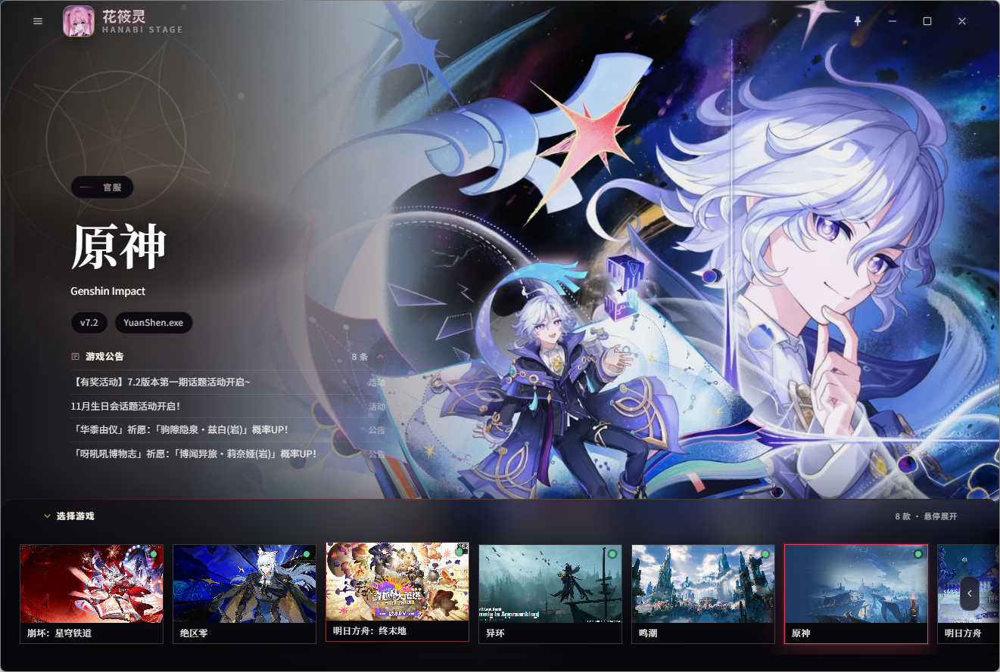

# 花筱灵启动器

[](https://github.com/Sparkle0v0Hxl)
[](https://github.com/Sparkle0v0Hxl/HuaXiaoLing-Launcher/releases/latest)
[](LICENSE)
[](https://github.com/Sparkle0v0Hxl/HuaXiaoLing-Launcher/releases/latest)
[](https://github.com/Sparkle0v0Hxl/HuaXiaoLing-Launcher/releases/latest)

> **作者：[Sparkle0v0Hxl](https://github.com/Sparkle0v0Hxl)** —— 独立开发与维护。
> 问题反馈请开 [Issue](https://github.com/Sparkle0v0Hxl/HuaXiaoLing-Launcher/issues)，作者与贡献者名单见 [AUTHORS.md](AUTHORS.md)。
> 交流群：**QQ 群 1018651207**（启动器「设置 → 关于」里点一下也能复制群号）。

> [!WARNING]
> **未签名程序，首次运行请先加杀软白名单**：启动器没有代码签名证书，且会调用系统能力解压更新包、随包带 `hpatchz.exe`（更新补丁合并组件），叠在一起正好是杀软误报特征，可能被拦、被隔离。把**安装目录整个**（重点是 `resources` 子目录）加进杀毒软件排除项后再运行。

> [!IMPORTANT]
> **提 issue 之前先看 [📌 提问规范 · 反馈前必读](https://github.com/Sparkle0v0Hxl/HuaXiaoLing-Launcher/issues/2)**
>
> 必须带上：**启动器版本 · 系统版本 · 复现步骤 · `data\crash.log` 日志 · 问题截图或录屏**。
> 只写「打不开」「闪退了」、不带日志和截图的一律会被要求补齐后再处理。

**当前版本：v2.14.0**（正式版）

一个**完全便携**的 Windows 游戏启动器。把《原神》《崩坏：星穹铁道》《绝区零》《鸣潮》《异环》《明日方舟：终末地》《明日方舟》《崩坏3》《蓝色星原：旅谣》收进同一个舞台，支持多服务器客户端共存与一键切换，顺便把抽卡记录、音乐播放和官方公告也一起做了。

> 原创实现，与米哈游 / HoYoverse、鹰角 / Hypergryph、完美世界、库洛游戏均无隶属关系。界面与代码为原创，内置的装饰图与角色立绘为程序化生成的自制素材；主题包功能允许用户自行放入喜欢的素材，其中涉及的官方立绘、光锥图或同人二创版权归各游戏官方 / 原作者所有，仅限本机自用。封面与动态背景在联网时从官方页面获取并缓存到本机。

---

## 它是什么



> 启动页实拍：左侧是当前服务器与游戏公告，下方「选择游戏」横排 9 款封面，点一下就连切带启动。

不是又一个「点击启动 exe」的壳。它解决的问题是：

- 一个游戏装了官服、B服、国际服三份客户端，硬盘被同样的资源吃掉三遍；
- 每次换服都要去翻不同的安装目录、不同的启动器；
- 抽卡记录散落在各种工具、导出文件和官方接口里，看不到统一视图。

花筱灵启动器把这三件事收进一个界面，并且**不往 C 盘写任何东西**——整个文件夹拷走就是完整搬家。

---

## 核心能力

### 多服务器与硬链接去重

同一个游戏可以同时挂官服 / B服 / 国际服（终末地还有 Play / Steam，鸣潮还有 WeGame 版），当前服务器在启动页一眼可见，点一下就连切带启动。

当两个客户端在同一磁盘、且某些文件完全相同时，可以把它们合并成一份数据：

- 只处理**相对路径相同、大小相同、内容哈希相同**的文件；
- 不同文件、独有文件、存档一律不动；
- 支持「完整校验」（SHA-256）和「快速比较」（首尾各 1MB）两档；
- 合并后两边仍然从各自目录启动，互不影响。

> 跨盘会直接拒绝（Windows 硬链接限制）。更新前建议保留官方启动器兜底。

### 启动页

- **官方动态背景**：终末地取官网首屏视频，异环直接读本机官方启动器里的 `bg.mp4`；
- **自动去文字**：官方图常烧录标题，启动页会用「去字版本」做背景，静态图按网格检测文字块并用周边像素填补，视频则叠加定向遮罩带；两者都能和启动器自己的标题共存；
- **动图可暂停、可导出**：右下角两个按钮，暂停状态按游戏记忆，导出走「另存为」对话框；
- **服务器胶囊**：一行列出所有渠道，点击即切；右上角齿轮打开完整管理面板（重建、编辑、目录、清除、移除全在里面）；
- 窗口最小化 / 最大化 / 关闭按钮就在启动页右上角，不用退回主界面。

### 抽卡记录

七款游戏统一成同一套界面：概览 KPI、卡池垫数、卡池统计、最近获得，出金带「X 抽」垫数徽章与角色立绘。

数据来源：

| 游戏 | 来源 | 更新方式 |
|---|---|---|
| 原神 / 星铁 / 绝区零 / 崩坏3 | 本地抽卡数据库 / UIGF 导出 | 自动读取，也支持官方 webCache 增量同步 |
| 明日方舟：终末地 | 官方 `ef-webview` 接口 | 网页登录后自动从游戏日志取 Token，角色池 + 武器池一起拉 |
| 鸣潮 | 本地日志里的带签名链接 | 游戏里点一次「抽卡记录」页的分享，启动器读到链接后自动拉取 |
| 异环 | NTE_Gacha_Exporter 导出 JSON | 导入后自动补全名称与头像 |

**图鉴自动更新**：终末地角色名与立绘取自官网干员页，异环取自官网角色头像 + 社区名称表；缓存 24 小时，新版本上线后下次刷新就会带上新角色，不需要改代码。抓取失败一律回退旧缓存，抽卡页不会因为网络问题打不开。

### 点歌台

- 内置 NeteaseCloudMusicApi，首次使用自动在后台启动，无需手动装服务；
- 网易云走官网网页端登录（内置浏览器打开 music.163.com，扫码 / 手机号 / 邮箱都行，登录完窗口自动关闭并保存会话）、歌单导入、关键词搜索、歌词同步、音质切换（标准 / 较高 / 极高 / 无损 / Hi-Res）；
- 四种播放模式：顺序、列表循环、单曲循环、随机；
- **3D 音效**：原声 / 宽阔声场 / 音乐厅 / 耳机 HRTF / 低音增强 / 人声清晰，强度可调；跨域音源会自动回退原声并提示；
- **弹幕点歌**：连上直播间后，弹幕发「点歌 歌名」自动搜索入队。B 站走官方 WebSocket；斗鱼、虎牙、抖音、快手、YY、网易CC、花椒、酷狗直播、小红书、淘宝直播、Twitch、YouTube 走后台隐藏窗口抓聊天区（视频流会被拦掉，不占带宽）；没适配过的站点还能用通用抓取试一把；
- 可拖动的迷你播放器，跨页面不中断播放。

### 官方公告

九款游戏的官网公告汇总成一张墙，每 10 分钟自动刷新，启动时后台预取，点开即跳官网。

### 其他

- **游戏库**：封面自定义、搜索、筛选、收藏、游玩时长统计；
- **游戏更新一键装**：官方出新版时启动页的「开始游戏」自动变「更新游戏」，点了就下、进度实时可见，下完自动变回；更新永远写真实安装目录，硬链接运行时秒级重建，多服不重复下载；
- **下载管理器**：http/https 直链，断点续传、暂停、继续；
- **HoYo Sophon 差异更新**：按官方清单比对文件 MD5，硬链接复用已有文件，只下载缺失分块；
- **渠道包按需下载**：终末地 / 明日方舟的渠道差异包不随安装包下发（安装包体积不因此变化），首次切到缺包的服先弹框写明体积，确认后才下载，可取消续传；「渠道包管理」窗口可对每个渠道单独下载 / 更新 / 释放，官方发版同步可按游戏开关；
- **管理员权限只问一次**：首次启动需要 UAC 的游戏问一次即可，选「以管理员重启」后自动续开，不再每次弹窗；
- **星铁解锁帧率**：工具页画质配置里切 30 / 60 / 90 / 120；
- **外观**：深色 / 浅色 / 跟随系统，八种强调色，自定义称呼与头像；
- **界面音效**：WebAudio 合成，无需资源文件；
- **公告页**、**动态页**、**下载页**、**设置页**各司其职。

---

## 完全便携

程序不在 C 盘留任何数据。所有内容都在启动器文件夹旁边：

```
花筱灵启动器\
├─ 花筱灵启动器.exe
├─ data\          ← 配置、登录会话、封面、背景视频、抽卡数据、缓存
├─ downloads\     ← 下载的游戏、更新包、导出的动图
└─ resources\     ← 程序资源（含内置网易云 API）
```

- 如果放在不可写的位置（例如 `Program Files`），会自动退回系统 AppData，避免启动失败；
- 旧版本放在 `%APPDATA%\花筱灵启动器` 的数据会在首次运行时**自动迁移**过来，只搬配置、登录、封面和背景，缓存直接丢弃；
- 备份只需要拷 `data` 文件夹。

> 唯一的例外：终末地抽卡 Token 必须从游戏自己写的 `AppData\LocalLow\Hypergryph\Endfield\sdklogs\HGWebview.log` 读取，这是游戏的位置，只能读不能移。

---

## 上手

1. 解压 `HuaXiaoLing-2.14.0-Portable.zip`，整个文件夹放哪儿都行（建议非系统盘）；
2. 双击 `花筱灵启动器.exe`；
3. 内置游戏会自动扫描注册表和常见安装目录，没找到就在「启动页 → 齿轮 → 自动检测」或手动指定 exe；
4. 想加别的游戏，主页点「添加游戏」。

### 硬链接切换服务器的正确姿势

1. 分别安装好不同服务器的客户端，**不要装在同一个目录**；
2. 在启动页点服务器胶囊旁的齿轮 → 「管理服务器」→ 为每个客户端指定启动程序；
3. 关闭游戏和官方启动器，点「硬链接去重」；
4. 第一次建议用「完整校验」，确认文件一致后再合并；
5. 之后点服务器胶囊就能连切带启动。

### 终末地

- 渠道差异包不随安装包下发：首次切到缺包的服务器会先弹框写明这次到底要下多少（体积按这次实际要下的内容算，随游戏版本变），确认后才下载；
- 各渠道体积差别很大：国际服 / Play 连 `Endfield.exe`、`GameAssembly.dll` 这些本体二进制都是各自发行的另一份，所以下的是整份差异，比只换 SDK 的渠道大得多；
- 「渠道包管理」窗口可以看每个渠道的就绪状态，单独下载 / 更新 / 释放；官方发版时的自动同步可按游戏开关；
- 启动走官方托管：由你机器上的鹰角官方启动器（`Games.exe`）亲自拉起游戏进程，本启动器只替点那颗「开始游戏」——父进程就是真官方启动器，不改游戏文件、不注入、不读内存；
- 因为官方启动器本身要求管理员权限，这一步仍然需要提权；UAC 只在第一次问，选「以管理员重启」后自动续开游戏；
- 切到非官服渠道时，安装目录会用目录链接临时指向对应渠道的运行时，游戏一起好就复位；官方启动器若正在下载 / 更新，启动会被拒绝并提示先切回官服更完，避免把渠道运行时写坏；
- 官服文件硬链接生成运行时，只覆盖渠道差异文件，原官服目录不会被修改。

---

## Windows 安全提示

便携包是**未签名**的 Electron 程序，SmartScreen / Defender 可能提示「未知发布者」或「对电脑有危害」。这不是因为包含恶意代码，而是没有代码签名证书、文件没有下载声誉。

**不要为了运行它而关闭系统安全防护。** 请先核对发布页提供的 SHA-256，确认来源可信，再选择「更多信息 → 仍要运行」。正式分发需要 OV / EV 代码签名证书。

---

## 已知限制

- **Sophon 更新**只做文件级覆盖与补齐，不处理官方清单里的删除项，也不重建被改名的文件；更新前建议保留官方启动器兜底。
- **硬链接**仅限同盘；官方启动器如果原地覆盖文件，可能同时影响两边。
- **终末地必须装官方启动器**：启动要借官方启动器拉起游戏，没装的话会在启动前直接提示，不会退化成其它方式。
- **原神 / 星铁 / 绝区零 抽卡**只读取本机已同步的数据库，不代替游戏登录。
- **异环抽卡**没有公开接口，只能导入 Exporter 导出的 JSON。
- **异环图鉴**只能匹配官网已公布的角色（约 19 位），未公布的会用首字兜底。
- **终末地武器池**已接入同步，但界面暂未按武器类型分组。
- **弹幕点歌**：B 站最稳（官方协议）；斗鱼 / 虎牙 / 抖音 / 快手 等平台靠后台隐藏窗口读页面聊天区，平台改版或需要登录时可能抓不到，状态栏会如实说明。
- **无损音质**需要网易云会员，未登录通常返回 320kbps。
- **动态背景去文字**是基于亮度方差与边缘密度的启发式检测，不是 OCR，文字压在复杂背景上可能擦不干净。

---

## 开发

```powershell
pnpm install
pnpm start
```

打包 unpacked 目录：

```powershell
pnpm pack
```

注意 `build.files` 只包含 `electron/`、`src/`、图标和文档，**不包含** `resources/netease-api` 与 `resources/endfield-packs`，打包后需要手动补进 `resources/`。

### 技术栈

- Electron 45，主进程 `electron/main.js`（约 13200 行，IPC 已按业务域拆成 40 多个 `*-ipc.js` 分片），渲染层原生 HTML/CSS/JS，无框架无构建步骤；
- 渲染层通过 `preload.js` 暴露的 `window.launcher` 调用 IPC，开启 `contextIsolation` 与 `sandbox`；
- 领域模块：`link.js`（硬链接）、`link-source.js`（跨服硬链接复用）、`runtime.js`（运行时）、`sophon.js`（差异更新）、`hdiff.js`（补丁）、`endfield-packs.js`（渠道包）、`endfield-launch.js`（管理员启动）、`game-channels.js`（渠道能力总表）、`endfield-gacha.js` / `gacha.js` / `gacha-import.js` / `gacha-sync.js` / `gacha-meta.js`（抽卡）、`kuro-packs.js` / `kuro-predownload.js`（鸣潮）、`yostar-packs.js`（明日方舟）、`background-clean.js`（背景去字）、`starrail-fps.js`（注册表帧率）、`downloads.js`、`store.js`、`seed.js`。

测试钩子：`HX_SMOKE=1` 启动冒烟、`HX_CAPTURE=1` 生成页面截图、`HX_USER_DATA` 隔离数据目录。

---

## 更新日志

每次功能更新都会写进启动器内的「动态」页，最新条目排在最前面，欢迎指南仍然保留在其后。

<details>
<summary><b>展开版本历史</b>（v2.14.0 → v1.0.0）</summary>

<details>
<summary><b>v2.14.0</b></summary>

**蓝色星原：旅谣**正式加入（官服 / B服 一键切换，走官方启动器托管）；启动页侧栏新增「菜单键固定」；安装器从 283MB 瘦到约 175MB、界面全部自绘、卸载改成程序内置窗口；顺带修掉管理员权限死锁、终末地官方托管超时、终末地预下载误判与一批体验问题、音乐页搜索分类与模块循环依赖，补齐鸣潮 UHD / 方舟台服 / 崩坏3 B服 / 异环与跨服预下载复用，并加上硬链接安全加固、运行时一致性检查、热更层善后、客户端渠道判定重写、素材转 WebP。

- **新增《蓝色星原：旅谣》**：第 9 款游戏。渠道身份完全由启动器目录里一个 192/368 字节的加密文件 `res/app_config.dat` 决定（官服 C000 / B服 C001），换服只换这一个文件，`launcher.exe` 和其余 79 个文件一个不动。渠道文件从哪儿来有三条路：本机已切换过 → 直接用缓存；本机装了对应渠道的启动器 → 直接读它的；都没有 → 从官方安装包提取（用 HTTP Range 只下 3~15MB，不是 182MB 全包）。
- **蓝原启动走官方启动器托管**：直接 spawn `AzurPromilia.exe` 会让 ACE 报「安全组件发生异常」（实测外部 `OpenProcess` 一律 `OPEN_FAILED:5`），因为蓝原和终末地一样校验父进程必须是官方启动器。做法是提权起 `launcher.exe` 并开 CDP，调它自己的 `r2m.gameEntry` 通道，让它走完整启动链把游戏拉起来，检测到游戏进程就关掉启动器 —— **游戏父进程始终是官方启动器，ACE 看不到任何异常**。
- **蓝原 B服 渠道件自愈（86 条）**：硬链接把官服整棵树镜像过去后，游戏目录里的渠道身份文件仍是官服，表现是「B服启动器拉起来了，进游戏却是官服」。逐文件比对 40527 个文件得出 86 条差异（内容不同 11 个 + 仅 B服 75 个），写入时先 `unlink` 再写（否则会穿透到官服本体），下完校验 size + md5。
- **启动页侧栏「菜单键固定」**（新开关，设置 → 行为，默认关）：开启后启动页打开侧栏不铺遮罩、画面完全可操作，左上角变返回箭头，底部「收起侧栏」只切宽度不关抽屉，离开再回启动页自动恢复展开。修掉 13 个真问题，其中三个是：菜单键/返回箭头落在 `-webkit-app-region: drag` 拖拽区里被系统吞掉真实点击（CDP 注入点击不经过该判定，所以自动化一直绿、真机一直点不动）；窗口基准在收起时被清空导致每开合一次宽 72px；回启动页后箭头前 100~200ms 停在旧坐标。
- **终末地一批体验修复**：老是提示新版本（状态记 1.6.4、盘上已 1.7.2，改为按字节复核）；硬链接收尾卡几十秒（2,567 次 `fsutil` spawn × 52.8ms ≈ 136 秒，改后台记账 + 卷序列号缓存）；国际服报「文件损坏」（junction 在检测到 exe 后 3 秒就复原，国际服还在读资源，改为游戏退出后才复原）；启动前两条多余提醒改真正一次性落盘；右下角 toast 噪音按渠道+版本落盘去重；启动成功后官方启动器的收尾改后台，界面不再白挂「启动中」最多约 20 秒。
- **其他游戏**：鸣潮 UHD 三档贯通并修掉 UHD 客户端「更新游戏」按钮不亮、渠道识别改读 `KRSDKConfig.json`；明日方舟台服以国服客户端为源生成独立运行时、`game-launcher-config.json` 的 tag 精确区分 EN/JP/KR；崩坏3 B服无官方清单时给明确文案；异环支持官方启动器开关与 `switchIni` 官服/B服切换。
- **跨服预下载复用 + 文件记账**：米哈游系预下载时其它服已下过的同类文件直接硬链接不重复下载；新增 `game-file-db.js`（SQLite 用项目自带 sql-wasm，零原生依赖，按 NTFS FileId 判断同一文件而非比内容），老用户升级后启动 8 秒后台补记账；配合 `migrations.js` 声明式迁移表按条目清理「功能被替换后的遗留数据」，用户素材包与导入的音源脚本绝不触碰。
- 安装器重做：安装包只带 resources，安装时复用安装器自己的 Electron 运行时，体积从 283MB 降到约 175MB。
- 卸载改成程序内置：旧做法把安装器自己复制成 `Uninstall.exe`，但 Electron 只认执行文件同目录的 `resources\app.asar`，那份是启动器本体，所以双击它跑的是启动器。现在卸载由主程序认 `--uninstall` 参数，走专用卸载窗口，只保留 `data`。
- 管理员权限判定：以前只靠 PowerShell `IsInRole`，且「拒绝过 UAC」存成永久布尔 —— 拒绝一次就永不提权，而清掉它的分支要求「已经是管理员」，互相锁死。现在三路探测（兼容层 / 令牌完整性 / PowerShell），拒绝状态改 10 分钟冷却。
- 终末地官方托管必然超时：查询按钮状态的消息少了 `callbackEvent` 字段，官方前端靠它决定回包挂哪个事件，缺了就不回报。补上后点「开始」一秒起游戏。
- 终末地预下载被误判不完整：校验产物用了正式更新清单（应该用预下载清单），字段名笔误导致恒取正式清单，于是判不完整并回落全量重下。
- 音乐页搜索加「搜单曲 / 搜歌单」；歌名过长改成单行省略 + 悬停显示「歌名 · 歌手 · 专辑」全名。
- 音乐模块循环依赖（`normalizeSourceFlags is not a function`）：改成惰性 require，搜索/换源/取地址恢复。
- 硬链接安全加固：新增进程探活（按 exe 路径前缀 + `tasklist` 双探测）、`launching` 启动占位、Windows 占用探测（`r+` 试开）、EPERM/EBUSY 中文提示 —— 游戏运行中不再可能把运行时写坏。
- 新增运行时一致性检查（`runtime-check.js`）：只在关键文件上比 `(size, mtime)`，能区分「本体更新了运行时没跟上」和「跨发行版本来就该不同」，不误报「文件损坏」。
- 新增热更层善后（`game-heat.js`）：只有终末地的 IFix 补丁没有自愈能力，才由启动器插手归档/恢复；米哈游三款的 `*_versions_persist` 一律不动，避免让用户白重下十几 G 语音包。
- 全部素材转 WebP：`src/assets` 15 张图从 PNG 转码，`theme-pack.js` 的 `resolveAsset` 自动回落同名 `.webp`，`hxl-art://` 白名单口径不变。
- 清理与工程：删掉死代码 `electron/azur-runtime.js`；5 处仍按名字调 `powershell.exe` 的模块统一走 `ps-path.js` 绝对路径（含 32 位 Sysnative 兜底）；默认下载目录不再启动就 `mkdir`；同步脚本备份每种只留 3 份（实测曾堆 302 份共 6.28GB）；安装器构建改白名单复制，不再把渠道包缓存与用户音源脚本打进包。

</details>


<details>
<summary><b>v2.13.1</b></summary>

B服生成后显示目录丢失、硬链接报 PowerShell 找不到、增量更新看着没变化、完整包下完卡住不重启 —— 这一版把这些都按根因修掉了。

- 这版没有新功能，全部是照着用户反馈的现场问题改的根因。
- B服生成完显示「目录已不在」：之前判断目录在不在用的是「是不是文件」这个判据，目录永远被判成不存在。现在目录存活性单独判据，只有真删了才提示。
- B服生成完显示「客户端不完整」：生成流程是「链文件 → 装渠道 SDK → 写 config.ini」，中间 SDK 装失败时 config.ini 还停在官服版，于是被判成渠道不对。现在生成成功时会明确写下渠道状态，不再依赖读配置文件倒推。
- 硬链接过程报 spawn powershell.exe ENOENT：解压 B服渠道 SDK 要调 PowerShell，之前直接写名字靠 PATH 找。有些机器 PATH 被安全软件改坏后就找不到，整个生成流程会卡在这一步。现在改成先按系统目录定位绝对路径，找不到才退回按名字找。
- 增量更新看着没效果：增量包里一直带着「这版删掉了哪些文件」的清单，但覆盖脚本从来没读过它 —— 于是升级完旧音源脚本、旧登录模块、qrcode 依赖全都留在原地，界面行为跟新版对不上。现在覆盖完会按清单清理，并顺手收掉留下的空目录。
- 完整包下完卡住不重启：覆盖脚本最多等主进程 60 秒，而主进程原来只发一次退出请求，被托盘或杀软扫描拖住就干等。现在退出请求发出 3 秒后强制退一次，保证覆盖脚本能接手。
- 另外把「网易云服务依赖自愈」补进了覆盖脚本：音乐页要用的 axios / express 被删掉时，升级时会自动补回来，不用重装。

</details>


<details>
<summary><b>v2.13.0</b></summary>

终末地支持走鹰角官方启动器托管启动，识别不到可手填 Games.exe，启动前把要弹的权限一次讲清楚；主题包升级成 18 个图位可自由替换，深色浅色都跟包；音源改成只认导入、导入即带自己的标签；切服报文件缺失与开始游戏连点一并修掉。


**终末地官方托管**

- 终末地的启动链路上了一条新路：优先交给鹰角官方启动器的 Games.exe 亲自拉起游戏，游戏看到的直接父进程就是官方本体。这条链路对反作弊最老实——我们的进程不参与拉起，也就不需要伪装父进程。官方托管走不通时会自动退回原来的签名父进程链路，不会因此点不动。
- 前提要讲明白：机器上得装着鹰角官方启动器。找它是动态的，注册表、卸载项 InstallLocation、盘符兜底三层一起找，找到目录后按层级搜 Games.exe，不写死版本号，装到别的盘、升到别的版本都认。万一确实找不到（绿色版、挪过位置、精简系统），设置 → 行为里新加了一个「终末地官方启动器路径」，可以手填 Games.exe，填错会提示无效并自动退回自动发现。
- 权限也是真会弹的：Games.exe 自己声明了 requireAdministrator，非管理员启动时必然弹一次 UAC；启动器这边需要提权时优先用自带的 elevate.exe，没有才走 PowerShell 的 RunAs，点了「否」也有普通实例兜底。杀软这块只能如实说——会不会弹、弹几次是杀软自己的判断，我们唯一能做的是建议把安装目录（重点是 resources 子目录）加进排除项，做不到「保证不弹」。这些现在都在启动前用一条提示讲清楚，而不是等报错才猜。
- 官方托管失败时会按原因分类给中文提示：命中安全软件/白名单 → 提示放行一次；命中管理员/UAC/RunAs → 提示这是权限弹窗不是报错；游戏已经在运行 → 提示不用重复启动；还没检测过游戏路径 → 提示先检测。不再是一句笼统的「启动失败」。

**主题包体系**

- 主题包从「换个配色」长成了「一套图 + 一套配色」：一共 18 个图位，角色立绘、双人卡、启动坞、页面挂饰、背景大图都能单独换。设置 → 外观里能直接给每个图位换图、还原，也能新建空白包或复制当前包当底子。
- 中文包名能识别了。原来的目录名校验只放行 ASCII，中文文件夹在第一道过滤就被丢掉——包里 16 张图明明都在，界面上却只有「内置」。现在按 Unicode 校验，中文、日文目录名都认，仍然挡路径分隔符、点开头、Windows 保留名和超长名字。
- 换包后「只换了一半」的两个根因也修了。一是配色：以前只覆盖 7 个基准色，卡片、分割线、次级文字还挂在旧皮肤上，现在按底色和强调色把最底层那批变量一起派生出来，浅色主题还会把包色按比例混白、把强调色压深到能当文字色用，不会出现深底深字糊成一片。二是素材缓存：图片地址不随包变，Chromium 一直用上一次的缓存，换包后拿到的还是旧图，现在给所有素材地址追包 id 与素材版本号，响应头也加了 no-store，换包和同包换图都会立刻重取。
- 侧栏立绘换成了官方全身立绘的透明底版本，用的是本地 ONNX 抠图（medium 模型）把背景去掉，alpha 残渣清零，深色浅色都是同一个角色本体，不再有方形底板、也不会在大腿处截断。页面挂饰与启动坞那几枚小图重画成元素化的 SVG：大黑塔是金链怀表与紫宝石钥匙，花火是狐面与双层烟花，符玄是占星罗盘与符纸挂签，火花是礼帽白兔与心形棒棒糖，52px 下也能认出来。品牌 logo 固定不跟包——`character-face.png` 跳过主题包目录，只按用户平铺和内置两层解析。
- 现成的包不用自己做：主题包单独发在 [HuaXiaoLing-ThemePacks](https://github.com/Sparkle0v0Hxl/HuaXiaoLing-ThemePacks) 仓库，也可以直接去主题包站挑选下载 —— 设置 → 外观里的「下载主题包」按钮就是跳这里。解压后把整个文件夹丢进 `art-pack` 即可，启动器扫描到就会出现在包列表里。

**第三方音源**

- 源码里不再内置任何第三方音源脚本，安装包里也不带。音源统一走「导入」：本地 JSON、在线订阅地址、`{ sources: [...] }` 订阅包、以及第三方脚本都能导入，导入后是音源卡上一个带名字的标签，点名字启停、点 × 删除。导入即用，不需要再去翻开关。
- 在线地址导入补了不少实情：跟随跳转、带浏览器 UA 与 Accept、HTTP 状态码直接报出来（404/403 看得见），GitHub 与 Gitee 的 `/blob/` 网页地址自动转 `/raw/`；清单里某一项只给 `{ name, url }` 且 url 指向另一份 JSON 时，会跟进一层合并（最多 8 项）；内容只有一行 http(s) 网址的 txt 也当在线音源处理；指向脚本清单的会明确提示不支持，而不是笼统报「不是合法 JSON」。
- 解析优先级理顺了：导入的脚本与自建音源排在内置源前面，同档保持导入顺序，失败才回退内置源。以前按 URL 宿主拦第三方 CDN 的做法也取消了——用户导入的音源常拿别家 CDN 当播放地址，按宿主拦会表现成「导入后识别不到」。结果标签从笼统的统一名称改成具体脚本名，脚本沙箱目录与注入的全局对象保持不变，那是脚本兼容所必需，属于接口不是内容。

**两个真机 bug**

- 闪断更新后切服全渠道报「文件缺失或损坏」。现象只在游戏内闪断更新之后出现，本机不复现，因为本机每个服进去都会先弹一次热更。现场取证后确认：`.chk` 语音包是官方下载器「临时文件 + 改名」落位的，改名不动 inode，跨渠道硬链接是安全的；真正会出事的是索引 json 和 `.blc`，闪断更新对它们是同 inode 原地写，一次热更把所有渠道的索引一起写新，但只有当前渠道下了对应 `.chk`，其它渠道就变成「索引说有 181 个、实际只有 137 个」，永远判缺失。现在启动前会扫一遍 `Endfield_Data\Persistent`，对 nlink>1 且非 `.chk` 的文件先拷贝再改名覆盖（不写穿 inode、保留 mtime），`.chk` 一律跳过。健康树是 0 次拷贝，老树一次性修好，之后各渠道热更互不污染。
- 开始游戏能连点。主进程本就有锁挡重复，缺的是渲染层那一瞬间的中间态：点了没反应，看起来像没点上，于是又点一次。现在点下去立刻把按钮切成「启动中…」并禁用，成功后等游戏真的 running 再解锁，失败或提权时先解锁再走原逻辑，另有 15 秒兜底防止卡在中间态。按钮用局部刷新，不整页重绘，背景视频不会被打断。
- 主页「游戏快启」的立绘少了一截。根因是一条 2026 年的历史规则给双人卡图片加了上下各 18px 的负 margin（当年是给 140px 矮卡和头肩特写用的），后来主页专用规则把卡片改成 236px、图片改 `contain` 贴底，却没清掉那条负 margin；卡片带 `overflow:hidden`，于是立绘上下各被顶出 18px 裁掉。定点补 `margin: 0` 解决。

**清理**

- 删掉了一批只在发版时用过一次的一次性脚本（仓库结构重排、旧版本清单、正文覆盖、资产替换、校验探针等 22 个）和已经没人引用的旧镜像分发模块，`scripts/release` 只留发版链路真正在用的那几个。发版脚本本身也做了收敛：GitHub 与 Gitee 的发行、源码、文档同步各有专责，参数统一，不再彼此复制。

</details>


<details>
<summary><b>v2.12.7</b></summary>

修复发布包漏带网易云服务依赖导致登录窗口起不来；修复更新弹窗文案堆成一整行；弹窗文案改简洁排版，两平台历史文案一并重写。


**登录窗口**

- 有用户反馈音乐页的网易云登录窗口打不开，但开发者本机正常。根因是打包时 electron-builder 把内置服务目录 resources\netease-api 下名为 node_modules 的目录当成生产依赖裁掉了，发布包里服务因找不到 axios 直接退出，登录链路第一关就断了。本机一直用完整的运行副本，所以没暴露。现在打包配置里单独为这个 node_modules 加了一条复制规则，并在打包脚本里加了前后两道检查，缺依赖直接让打包失败，不会再悄悄发出坏包。

**更新弹窗文案**

- 更新清单里的 notes 是数组，客户端读的时候用了 String(数组)，JS 会用逗号把它拼成一整行，而渲染层只按换行拆分——结果所有要点堆在一条里，看着是一坨。现在读清单时先把数组按行拼好，渲染层就能正确拆成一条条。

**排版固化**

- 更新弹窗文案改成简洁排版：第一行是杀软白名单提示，第二行是版本号，后面是几条「动词前缀：短句」，同类合并、一行一件事。这个规则已经写进打包脚本，排版不合规直接打包失败，文案以后不会再乱。两平台以前发过的更新文案也按这个排版重写了一遍。

</details>


<details>
<summary><b>v2.12.6</b></summary>

启动检测游戏从 8 秒降到 1.8 秒，解压更新包快 1.56 倍；终末地三个渠道共省 7.26 GB 磁盘，旧的语音包备份会自动清掉；游戏下载缓存改边下边清；安装包小约 47 MB；增量更新退回整包的根因和歌单广场点不动一起修了。


**启动与解压**

- 启动阶段最耗时的不是扫目录，而是查注册表。米哈游那几个键（HKCU\Software\miHoYo\原神 之类）在装了多个渠道的机器上会膨胀到几 MB，reg.exe 走 /s 全树展开实测要 25.9 秒，而原来的超时是 2500 毫秒——每次启动都白等 2.5 秒然后放弃。现在把超时降到 600 毫秒（实测这个值对 35 个键一个值都不丢）、加进程内结果缓存、并且把 8 个游戏的探测改成并发。8 个游戏合计从 8012 毫秒降到 1811 毫秒。
- 解压更新包原来是逐个文件串行读、用同步 inflate 阻塞事件循环。现在改成 4 路并发 + 异步 inflate，204 MB 的便携包从 9.90 秒降到 6.35 秒（实测 6 路和 8 路反而更慢，磁盘 IO 到瓶颈了，所以固定在 4 路）。

**终末地语音包：从「拷三份」改成硬链接**

- 终末地每个渠道都有一份 Endfield_Data\Persistent（语音包），以前为了躲开 11-07 那次索引污染事故，整棵目录强制拷贝——官服、B服、国际服三个渠道就是三份 3.7 GB。实际事故元凶只有几个索引 json 和 .blc（合计 61 MB），而占大头的 178 个 .chk（3.63 GB）是官方下载器用「临时文件 + 改名」落位的，rename 不动 inode 数据，硬链接安全。
- 官方日志 G:\Arknights Endfield\sdklogs\HGDownloadLog.log 全程只有 move、没有原地覆写，77 条 .chk 补丁记录都指向 tmp 产物。现在改成按扩展名分流：.chk 走硬链接，.json 和 .blc 仍然强制拷贝。每个渠道省 3.7 GB。
- 顺带把那个每次重建运行时都会自动生成的语音包备份（7.39 GB）取消了——硬链接修好之后它已经没有存在意义，而且原来删掉还会在下次重建时长回来。老机器上已有的备份会在启动 3 秒后自动清理。

**下载缓存：边下边清**

- 游戏下载的分块缓存（sophon-cache\chunks）以前只写不删。硬链接建好之后缓存里的那份就是多余的，实测把 10588 个分块删掉后游戏文件依然完整、磁盘空间实实在在少了 20 GB。现在每个文件校验通过后按引用计数回收它用过的分块（并发安装时同一分块可能被两个文件同时需要，所以不能「用完就删」），整轮安装结束时清空 chunks 目录。
- 升级后还会自动清一次旧版本残留，标记写在 sophon-cache\.purged 里，同一个版本只清一次；正在下载或安装时跳过、不写标记，留到下次。

**安装包瘦身**

- Electron 默认带 55 个语言包共 48.82 MB，实际只用得到简体中文和英文两个（各 0.6 MB）。加了 electronLanguages 配置之后其余 53 个在构建时就被裁掉，安装包小约 47 MB。

**三个修复**

- 增量更新从 2.9.4 起每次都退回整包下载：打包基线里的 latest.json 是精简版（1116 字节），用户机器上是更新流程从远端拉的完整版（带签名和 deltas，1250 字节），打补丁前校验大小必然失败，而它又是补丁列表第一项，一失败整个增量就作废。现在构建增量包时按文件名排除它，客户端应用补丁时也跳过它。
- 歌单广场切换平台后点不动：切回已经加载过的平台时，ensurePlaza 直接 return 了，界面完全不动；另外广场的详情和「我的歌单」共用同一个 state，在「我的歌单」里点开过歌单之后切到广场还是看到那张旧详情，再点别的卡片看着就像没反应。两个都修了。
- 补丁工具 hpatchz 失败时会留下半截输出文件，而它下次遇到已存在的输出路径会直接报错退出——等于一次失败就永久失败。四个调用点里三个没有前置清理，都补上了。另外确认了不能给这个工具加 -f 参数：它是强制覆盖而不是「写临时文件再改名」，实测会把已经校验通过的好文件截断成 0 字节。

</details>


<details>
<summary><b>v2.12.5</b></summary>

主题扩展为 15 套皮肤，主题/皮肤/强调色可自由搭配；新增界面不透明度调节；启动页固定深色；修复增量更新一直退回整包、切歌单播放列表叠加旧歌两个问题。


**主题与外观**

- 主题拆成三个互不影响的维度：「主题」管明暗（深色 / 浅色 / 跟随系统），「皮肤」管底色倾向（共 15 套：原色、深夜蓝、樱霞、霜青、暖木、海洋深处、落日大道、森林树冠、极简灰阶、金色时刻、极地霜蓝、沙漠玫瑰、科技前沿、植物园、午夜星河），「强调色」管按钮、进度和细节（8 种）。三者可以自由搭配。
- 新增界面不透明度调节（40%–100%），拖动实时生效、松手保存；只作用于侧栏、主界面和弹窗，不会把背景图一起糊掉。
- 启动页改为整页固定深色，不管外层主题是深色还是浅色，游戏卡片的名称和状态都清晰可读。

**问题修复**

- 修复增量更新从 2.9.4 起一直退回整包的问题：根因是更新清单 latest.json 被当成普通补丁，打包基线里是精简版、用户机器上是完整版，基准大小校验必然失败，而它又是补丁清单第一项，导致后面的补丁都没机会跑。现在 latest.json 不再进增量包，增量更新可以正常应用。
- 修复切换歌单时播放列表会叠加旧歌单的问题：以前点歌单里的某一首只会往后追加、从不清掉上一张歌单留下的歌，切几次就会越堆越多。现在切歌单会清掉别的歌单残留，但弹幕点歌、手动加的歌、直链和本地文件都会保留，继续按顺序播放。

</details>


<details>
<summary><b>v2.12.4</b></summary>

音乐页重做：三栏布局 + 平台标签歌单列表，「我的队列」和播放列表分开，支持新建本地歌单、批量选择、Shift 刷选；播放位置和上次歌单自动恢复，直链/本地歌曲自动搜歌词，换源不再改掉歌名。


**音乐页重构**

- 音乐页改成三栏：左边是歌单列表和平台标签（全部 / 网易云 / QQ音乐 / 酷狗 / 本地），中间是歌单详情 / 队列 / 广场 / 榜单 / 搜索，右边是正在播放和歌词。

**队列与本地歌单**

- 「我的队列」和「当前播放列表」分开了：手动加歌、直链、本地文件、最近播放进队列；点歌单播放只换当前播放列表，不会再灌满队列。队列页和歌单详情都支持批量选择，还能按住 Shift 拖动连续勾选。
- 可以新建本地歌单：整张播放、把队列导进去、单首移除、删除歌单都可以。
- 播放到第几首、上次打开的歌单、左栏选的平台标签都会记住，下次进音乐页自动恢复并把当前播放行滚到可见位置。

**其它改进**

- 直链和本地歌曲以前加进来不会搜歌词，现在会自动按「歌名 + 歌手」去搜，弹窗也补了歌手输入框，从「歌手 - 歌名.mp3」这样的文件名也能自动拆出歌名和歌手。
- 换音源时不再用别的平台的版本覆盖歌单里已经导入的歌名和信息。
- 启动器里的删除都只动本地数据，不会影响网易云 / QQ 音乐账号里的歌单；账号同步来的歌单没有删除按钮。

</details>


<details>
<summary><b>v2.12.3</b></summary>

鸣潮 SD / UHD 三档画质不再按 HD 处理，更新/修复/跨服硬链接都按本机真实档位；转 WeGame 少占 3.9 GiB。弹幕点歌支持轮播和未开播房间（需登录 B 站），B 站登录状态常驻显示，底部播放条可展开歌单，QQ 音乐大歌单加载提速约 8 倍。


**鸣潮画质档位**

- 以前鸣潮不管你装的是 SD / HD / UHD，更新、修复、跨服硬链接全按 HD 清单处理 —— SD 用户白下 42.6 GiB，UHD 用户被降级还丢文件。现在三档贯通：更新/修复/预演跟随本机已装档位，跨服硬链接跟随源客户端。
- 实测官方 3.8.0 三档清单各 924 文件：SD 真实占盘 0.79 GiB、HD 0.79 GiB、UHD 0.79 GiB（其余都能硬链复用）。
- 鸣潮转 WeGame 版现在会跳过未完成下载（.kuro-tmp）和着色器缓存（PSO），本机实测少占 3.9 GiB。
- 记账文件（launcherDownloadConfig.json）改为原子替换，中途关掉启动器也不会把配置写丢。

**弹幕点歌与音乐**

- B 站轮播和未开播房间的弹幕基本不推数据，但聊天区一直在。现在改用聊天历史轮询，这两种房间也能点歌。注意：B 站接口未登录时返回的聊天历史是空的，要先在卡片上登录 B 站账号。
- 弹幕点歌卡片头部常驻 B 站登录状态，未登录显示「登录B站账号」，已登录显示昵称并可切换账号。
- 底部播放条新增播放列表浮层，直接看当前 / 接下来 / 已播放，点一行就能切歌。
- QQ 音乐大歌单加载从串行改 5 路并发：1297 首的歌单选约 1 秒（原来约 8–9 秒）。

**其它改进**

- 点歌去重闸门统一了弹幕和轮询两路，同人同句 60 秒内只算一次；单字语气词误判已过滤。

</details>


<details>
<summary><b>v2.12.2</b></summary>

绝区零 B服 硬链接生成后显示「目录已不在」修了；官服和 B服共用目录的老问题修了，每个渠道一份独立目录；鸣潮深层目录误判、手动粘贴链接不生效、WeGame 版带错渠道身份也都修了。


**渠道目录**

- 点「硬链接生成一份」之后，B服那一行显示「目录已不在」——是渠道件识别只看了根目录，B服的渠道件其实装在 `<游戏>_Data\Plugins\x86_64\` 下面。现在三种位置都认。
- 官服和 B服共用一个安装目录的老问题也一并修了：以前启动器把「共用」当成正常玩法，第三方切换器改过配置.ini之后还会把官服目录错认成 B服。现在启动器会检查目录里的渠道件，确认归谁；判不归属时不动任何一行，判得出就把多占的那行清成「未配置」。

**鸣潮**

- 装在深层目录（主程序在三层下）的鸣潮会被误判成「不是官方客户端」，现在更新链路会向上找到本体根。
- 抽卡记录手动粘贴的链接不生效——粘贴的链接被日志里的旧链接顶掉了，而且字段名对不上等于没传。现在粘的链接优先。
- WeGame 版转换后会带着官服的登录身份进不去游戏，渠道件现在按目标渠道各写各的。

**其它修复**

- 插件权限弹窗点空白处关不掉（遮罩回调里有个没定义的变量，一报错弹窗就锁死了）。
- 鸣潮 WeGame 版转换按钮直接放在服务器那一行，不用再进弹窗找。
- 硬链接不再共享游戏运行时会改写的文件（音效、设置、存档类），两个渠道各写各的，互不串。

</details>


<details>
<summary><b>v2.12.1</b></summary>

明日方舟繁体中文服（台服）接进来了。


**方舟台服**

- 明日方舟繁体中文服（台服）接进来了。它是鹰角海外品牌 Gryphline 直营的繁中服，实测确认跟国服官服走同一套接口、同一把加密钥匙，所以能和国服互相硬链接：比对下来 35% 的文件（约 7.5 GB）可以直接硬链接复用，其余按台服自己的清单逐个文件核对补齐，差多少补多少，不会整包重下。
- 一键下载、检查更新、修复本体都通了，界面上和其它渠道一样。（预下载那项方舟官方至今没开放，界面不会给你一个点了只报不支持的假入口。）

**不能互链的原因**

- 台服跟日服 / 韩服 / 国际服不能互相硬链接——那三个区是 Yostar 自家的一套签名与校验方式，发行商和 CDN 都不同，同名文件内容对不上。硬链过去会做出「壳是国服、资源是别的区」的混合体，反而坏。这不是偷懒，是两边本来就不是同一套东西。日韩国际三区互相为源的功能早就有了，这次一并保留。

**鸣潮三处修复**

- 硬链接安全线：硬链接等于两个渠道共用同一份文件。运行时自己会改的那些文件（战绩、崩溃上报、账号相关、各渠道自己的 SDK 配置）以前可能被两个渠道一起改了，现在一律拷贝不共享。
- 本体根目录认错：游戏装在三层深的目录里时，客户端记账文件找不到，启动器就误判「不是官方客户端」，点更新直接报错。现在会自己往上找本体根目录，更新和抽卡日志都认得对了。
- WeGame 转换入口：原来那个四步转换教程只能从很深的地方点进来，最该用的官服反而没入口。现在服务器那一行直接多一个转换按钮。

**其它**

- 崩坏3 国际服的资源清单补上了（实测国际服有五个发行区，之前以为没有）；抽卡页空状态里少的那句鸣潮同步提示补回；几个只写了测试目的的校验脚本改成动态判断，不再误报失败；两处「界面给了入口、点了却报错」的能力表错配也修了。

</details>

<details>
<summary><b>v2.12.0</b></summary>

- 渠道能力收成一张表：以前「这个渠道能不能一键下载 / 能不能检查更新 / 能不能预下载」散在十几处各写一份名单，改一个游戏要翻半天，还容易两边打架。现在后端一张表（`electron/game-channels.js`）统一算好，前端一律读它。
- 崩坏3 的边界是实测出来的：官方 HoYoPlay 接口只有官服（`bh3_cn`）有资源清单，B服 和国际服查不到分支。所以它能硬链接、能修复，但一键下载和检查更新仍只有官服，界面上不会再给你一个点了必报错的按钮。
- 跨服硬链接补齐：一个服更到最新版之后，切到别的服点更新，会先拿已更新好的文件做硬链接，缺的才下差异。鸣潮和明日方舟（Yostar 三区）以前只能自己从头下，这版补上了；原神 / 星铁 / 绝区零 / 崩坏3 / 终末地 / 方舟国服 本来就有。
- 预下载也走同一套：四条预下载链路（米哈游 ldiff 补丁包、米哈游分块、终末地 Diffs 分包、鸣潮暂存目录）以前都是纯联网下载，现在都会先去别的服找同名同内容的文件直接硬链接过来。终末地以前在应用阶段被特意排除在外，现在放开了。
- 补回两个入口：崩坏3 的「硬链接生成一份」（上一版做渠道白名单时漏了，后端本来就支持）；鸣潮的「修复」（后端修复分支一直存在，只是界面上没入口）。另外「更新鸣潮」的 IPC 主进程早注册了，但 preload 没暴露，界面上根本调不到，一并补上。
- 启动图不再黑屏：以前要先加载数据、补种子数据、扫四个游戏安装目录、判一次管理员权限（同步跑一次 PowerShell），全部做完才建启动图窗口，这段 1.4~1.6 秒里进程一个窗口都没有，看着就是「点了图标先黑屏，然后直接进界面」。现在启动图提到 whenReady 第一行，实测从 1.5 秒提前到 0.7 秒左右。
- 异环国际服的路口留回来了：它没有官方渠道配置、做不了自动切服和预下载，但你真装了国际服客户端的话，至少要能选路径、能从花筱灵启动。点它会明确告诉你能做什么不能做什么。
- 终末地没生成运行时的行现在是黄灯「需要生成」而不是绿灯，点主按钮直接弹和别的游戏一样的生成面板。
- 其它：补了手动填写游戏 UID 的输入框（角色列表拉不出来时也能同步抽卡）；修了歌单链接或 QQ 音乐 cookie 带裸 % 直接报错；补了六个只存在于样式里却从没定义过的颜色变量。

</details>

<details>
<summary><b>v2.11.0</b></summary>

- 账号中心：登录入口统一收进左下角头像，点开是浮层，五个标签页（米游社 / HoYoLAB / 鹰角账号 / 完美通行证 / 抽卡账号）。每个标签页能看到当前登录的是谁、有哪些游戏角色，可切换或退出；米游社和 HoYoLAB 显示社区昵称与头像。抽卡页底部那个默认收起的折叠面板撤掉，页头「米游社账号」按钮改为直接打开账号中心。鹰角与完美世界官方未开放角色列表接口，登录后只存登录态。
- 抽卡头像与扫码登录：原神抽卡记录带角色和武器图标（图鉴取自米游社观测枢，角色 138 条 / 武器 253 条，日更 + 落盘缓存 + 失败回退）。登录改为扫码，不再需要手贴 Cookie。同步按 uid 认人，重复点击不再翻倍请求；限流单独识别并给冷却提示。
- 鸣潮预下载与更新重做：官方 3.0.1.0 起改用分包（bundle）协议，旧清单接口里没有预下载字段。按新协议重写后能正确显示下载量与所需空间；预下载落在 `_kuro_predownload/<目标版本>/` 暂存区，不触碰游戏本体，支持断点续传与取消；正式更新先核对线上版本与逐文件 md5，命中则从暂存区搬入，避免重下十几个 G。同时修掉中断信号传普通对象导致「清单读到、下载 0 个文件、两分钟后失败」的问题。鸣潮抽卡记录一并接入。
- 终末地切服修复：切国际服下载中文语音包后再切回国服，官服会持续报「检查资源完整性时发现异常」并反复下载。根因是各渠道运行时为省磁盘硬链接到基础客户端，`Endfield_Data\Persistent` 下的资源索引（`index_main.json` / `pref_main.json` / 各 VFS 的 `.blc`）被两个渠道共享，国际服改写后官服读到的记录与实际文件数不符。改为可写文件真拷贝，判据从「只看扩展名」扩成三重（目录段 / 文件名片段 / 扩展名）加两份实测清单；并修掉多段路径前缀匹配不上的问题（此前 `Endfield_Data/Persistent` 这条规则实际未生效）。整树重建时先搬 `Persistent`，不丢已下语音包。
- 主进程重构：`main.js` 里 11,302 行的 `installIpc()` 按业务域拆成 26 个 IPC 模块（音乐 / 服务器 / 直播 / 游戏 / 抽卡 / 森空岛 / 米游社 / 终末地 / 设置 / 窗口 / 预下载 / 通行证 / 截图 / 方舟 / 鸣潮 / 异环 / 下载 / 安装 / 背景 / 更新 / 对话框 等），`installIpc()` 降到 1,713 行 / 5 个 IPC，`main.js` 从 21,110 行降到 12,832 行。功能行为不变，只是结构更清楚。
- 抽出两个公共模块：`secret-store.js`（`loadSecret` / `saveSecret`，safeStorage 加密读写 `sessions.enc.json`，26 个模块共用）、`netease-client.js`（网易云客户端 + 播放地址回退链，11 个函数）。
- 崩坏3 静态背景不更新（用户反馈「经常拿不到最新静态背景图」）：修掉 4 处独立根因 —— 官方接口 `time` 字段为空导致排序失效、静态图只要文件存在就跳过检查、静态图只在拿不到视频时才生成、官方给的是 webp 却写死成 `.png` 扩展名导致解码失败。现在按 URL 日期段取版本、记录来源 URL 比对、静态图无条件核对、按真实格式落盘；米家四款同时加了动图新鲜度检查。
- 画质页：星穹铁道帧率卡片接回画质配置页（30 / 60 / 120 三档），之前 handler 在但界面没入口。
- 崩坏3 抽卡记录移除：官方接口域名不存在，从未开放补给记录；游戏本体支持不受影响。
- 清理：删掉 14 个全仓零引用的函数（约 300 行）、工具页旧的多 tab 结构残留、「账号登录」重复入口（现在只在左下角账号中心）。

</details>

<details>
<summary><b>v2.10.2</b></summary>

- 进度面板：任务坞撤掉，改成「开始游戏」按钮正上方一块进度条，下载 / 更新 / 硬链接生成 / 预下载四类任务都走它；没任务时整块不出现。面板本身是按钮，点开是对应的详情窗口。
- 面板版式：顶行阶段 + 百分比 + 预计剩余时间，下面三行是下载 / 安装 / 校验各自的完成量、总量与当前速度；速度只挂正在跑的那行，按 3 秒滑窗分阶段采样。
- 新增 `electron/progress-meter.js`：按阶段分桶采样、下载行优先 `netBytes`、校验行单独吃 `verifiedBytes`（`sophon.js` 没有独立 verify 阶段）。
- 硬链接生成接进面板：`hardlinkTree` / `overlayDirectory` 上报字节量与收尾满帧，`waitIfPausedLocal` 让暂停在硬链接阶段也真的会停。
- 设置页：9 组拆成 12 组（外观 / 窗口 / 音效 / 行为 / 游戏与渠道包 / 下载与网络 / 数据与备份 / 文件管理 / 更新 / 系统 / 社区 / 关于），下载限速与网络代理归「下载与网络」，管理员权限归「系统与权限」，抽卡云备份归「数据与备份」。
- 弹窗毛玻璃：半透明 + `blur(26px) saturate(1.45)`，最小化时关 blur 省 GPU，`prefers-reduced-transparency` 时退回不透明，浅色主题单独压深描边。
- 抽卡自动同步：去掉「游戏必须由启动器启动且仍在跑」的内存准入（提权重启会丢状态），改成只看抽卡缓存签名并扫描所有渠道目录；请求间隔 400ms、并发锁、限流识别成独立错误并给 10 分钟冷却，已抓到的先入库（`partial`）。
- 安装程序：Setup 换成自己的立绘、顶部小图、7 尺寸 ICO 与深紫配色（`MUI_BGCOLOR 1B1020`），欢迎 / 完成 / 卸载页文案重写。
- 移除 Mirror酱：`electron/mirrorchyan.js`、`update:mirrorchyan-test` 通道、设置页两行配置、`ASAR_MUST_HAVE` 条目全部删除；更新链路回到 Gitee → jsDelivr → GitHub，自动模式不再读手填地址。

</details>

<details>
<summary><b>v2.10.1</b></summary>

- 更新权限：修掉「点更新游戏提示文件被占用、要先开管理员权限」的误判——Windows 上「文件被别的进程打开」与「目录 / 文件不让普通权限删改」是同一个错误码，以前一律按占用处理。现在更新前先探目录能否写（只看不动、探完原样还回），文件缺删改权限的改用「改名覆盖」绕过去，多数情况不用管理员权限；真整目录不可写才提示提权，并给「以管理员身份重启并接着更新」按钮，重启后自动续做。
- 报错分诊：`humanError` 与卸载路径的文案不再咬定「被占用」，同时说明也可能是权限不足。
- 进度面板：更新 / 预下载弹窗改成三行式（下载 / 安装 / 校验各自完成量与速度）+ 总百分比 + 预计剩余时间；速度按 3 秒滑窗分阶段采样，总量未知时走不确定态而不是死卡 0%。校验以前混在写入里做，现在单列一行。
- 覆盖量：启动器底部任务按钮直接写「已下载 X / Y」，`DOCK_UPDATE_PHASES` 从 12 个阶段名补到 21 个。
- 硬链接生成：`hardlinkTree` / `overlayDirectory` 累加字节量并上报，切服时能看到扫多少 / 链多少 / 几个 G / 速度 / 剩余；新增暂停检查点，暂停真的会停（以前只有下载阶段能停）。原神国际服与明日方舟的硬链接调用点补上 `onProgress`。
- 预下载：同款三行面板与速度 / 剩余时间。
- 终末地渠道包与明日方舟更新以前没有 `phase`（界面永远停在「正在更新…」），现在补齐阶段与字节量；md5 命中、跨渠道硬链接复用、真下载三条路径都算进覆盖量，不再出现进度不动、速度恒 0。
- 新增 `electron/progress-meter.js`（速度 / ETA 计量，已登记 `ASAR_MUST_HAVE`）。

</details>

<details>
<summary><b>v2.10.0</b></summary>

- 下载限速：设置里「下载限速」0~100 MB/s 全局总带宽闸，改完即时生效，所有更新 / 预下载 / 渠道包共享同一个额度。
- 明日方舟补上日服 / 韩服 / 国际服（EN）三个 Yostar 区服：能下载、更新、修复、自动检测渠道、启动，三区独立目录互不覆盖；台服协议未验证，暂不接入。
- 终末地官服删了也能切服：官服 / B服 / 国际服 / Play / Steam 五个渠道的硬链接运行时现在可以任意互相为源重建另一渠道客户端——相同文件硬链复用、差异文件由渠道包覆盖成目标版重二进制；渠道专属 .exe / .dll 用独立副本防 inode 污染，缺关键件硬中止，重建失败不毁旧运行时与已下好的语音包。
- 米哈游四款 B服 / 国际服没生成独立客户端时不再误显示「与官服共用目录 / 可用」；已生成的硬链接运行时（含自定义「运行时目录」）能正确认出，不用重选路径。
- 星铁预下载下完切服再切回不再误报「可预下载」；启动加载图 GPU 首帧慢时不再空白。
- 明日方舟国服更新 / 修复加渠道守卫，台服与海外三区不再被国服全量清单 in-place 刷坏。

</details>

<details>
<summary><b>v2.9.5</b></summary>

- 启动加载不再「未响应」地卡一下：画质预读的注册表读取整链异步化，状态推送 / 配置探测 / 抽卡轮询的重复磁盘 IO 做了缓存与短路。
- 补上小功能：抽卡云备份「立即备份」、设置导出 / 导入、首页 30 天游玩趋势、原神 / 星铁 / 绝区零抽卡自动同步（手动取根加兜底）。
- 异环升到 1.5：版本 / 封面 / 动图都跟上，官方换图后自动重拉，修掉动图更新失效的赋值报错。
- 抽卡读取失败给中文提示、全退重开即恢复；自动更新落地 `app.asar` 改原子替换，配合同步工具的进程占用判据，避免旧进程读到写了一半的新包。

</details>

<details>
<summary><b>v2.9.4</b></summary>

- 读国际服官方清单遇到连接被重置、超时会自动有限重试并换条网络栈 / 线路，报错翻成中文（含域名与换节点指引）；不再一次 `read ECONNRESET` 就整句英文甩给界面。
- 自动更新：小增量包下载失败换镜像线路重试、解压后按 ZIP 文件条目数复核有没有解全（抽出半截明确报错）、失败时进度区收口、stage 报错带诊断文件完整路径与缺项、诊断导出纳入 `launch.log` 与 `stage-debug.json`。
- 弹幕点歌·B 站：只有服务器确认鉴权（op=8）才算真连上，空 key 不再假「已连接」；加读超时看门狗，去掉「重连 3 次断开」硬上限改指数退避长期后台重试，掉线强制重取弹幕 key。
- 弹幕点歌·其它平台：正文改从专门文本节点取（不再把用户名混进正文导致 `点歌` 认不出来），加载完校验是否真进聊天区，页面跳转 / 渲染进程异常后自动重注入并有限次自愈，累计弹幕数口径与 B 站统一。点歌写法放宽、多条按房间排队 + 去重 + 单条硬超时，不再被全局锁整批丢；没匹配上也有提示。计数与最近弹幕断线后保留只读展示，事件订阅可解绑。
- 设置里的「运行时目录」自定义后多出「恢复默认」按钮，点一下清空、回到留空＝自动「游戏盘:\VelaRuntimes」。

</details>

<details>
<summary><b>v2.9.3</b></summary>

- 启动页「开始游戏」正下方新增渲染后端开关：默认 / DX11 / DX12，点一下就切。只对实测能切的五款出现——原神、星铁、绝区零、终末地传 `-force-d3d11` / `-force-d3d12`，异环传 `-dx11` / `-dx12`；崩坏3 与明日方舟不提供。游戏运行中、未安装、不在支持表时整行不出现。启动 45 秒后回读 `Player.log` 把实际后端写进启动日志。
- 异环官方开放预下载后，启动页会识别并显示「去官方预下载」：拉起官方启动器（已开着就切前台，不杀掉）并尝试自动点预下载；官方进程运行期间不替换 `NTELauncher` 文件。异环资源清单为私有加密、资源地址需登录态换密钥，因此只做检测与引导，不代下本体。
- 更新链路按真实清单与真实客户端重跑一遍：国际服先硬链接再打 ldiff 补丁（实测省流 84.7%）、国际服 ldiff 因 `config.ini` UTF-16 被当 UTF-8 读而从未生效的问题修掉、终末地接上跨渠道复用（实测 20/20 零下载，并修正清单字段 `path` 与 `file` 不匹配导致静默全量下载）、异环 size=0 却配 md5 的瑕疵条目不再每次重下、异环写盘改为临时文件 + rename。
- 更新与预下载开跑前先算磁盘空间，运行中每 1.5 秒复查，不够当场停并说明还差多少；读不到磁盘信息时放行。
- 「修复游戏」改为整份读盘算 md5（原来只比首尾分块，多分块文件中间损坏会漏检），更新路径仍是快速判定。
- 硬链接「快速比较」文案改为「仅估算」，且执行阶段强制全量校验，抽样只用于预览。
- 异环 `Config.ini` 编码自适应（UTF-16 / UTF-8 / BOM），B服不再拿到官服清单。

</details>

<details>
<summary><b>v2.9.3-alpha1</b></summary>


- 硬链接生成不再「假死」：生成 B服 / 国际服运行时卡在「第 1/5 步 · 读取官方清单」不动，其实不是卡住——清空旧运行时目录撞上 Windows 的 EPERM（这次是 `YuanShen_Data\webCaches\2.36.0.0\Service Worker` 被残留句柄咬住），任务当场就失败了，界面还挂着「正在读取官方清单…」的滚动动画。
- 清理旧目录改成三档容错：整树删除带 10 次重试 → 逐项删除只看真正删不掉的 → 还有残留就把整个旧目录改名让路（同卷 rename 只要求父目录可写，子目录里的句柄不挡路），新目录照常建。只有改名也失败才报错，文案是中文并直接说清下一步该做什么。
- 失败不再假装在跑：出错时进度区立刻收口成「已中止 · 原因见下方」，滚动动画停掉；EPERM / EBUSY 翻成中文并带出具体路径，ENOSPC / EACCES 也各有一句能照做的提示。
- 清理与扫描都有文案：清理时显示「清理上次残留的运行时目录…」，扫描基础客户端按 400 ms 节流上报，能看到已经数到第几个文件。原神 B服、终末地、明日方舟三条硬链接路径统一走同一套实现，明日方舟的渠道文件覆盖改成删不动就跳过这一件。
- 版本号从这一版起按 semver 走：修 bug 升 patch、加功能升 minor、破坏性改动升 major，预发布加 -alpha1 / -beta1 / -rc1，转正式时去掉后缀。

</details>

<details>
<summary><b>v2.9.2</b></summary>


- 更新与预下载的安装阶段从 4 路并发提到 16 路：一个文件一路，各自独立解压与写盘，收尾不再排成一队。同机基准（600 个 400KB 小文件）NVMe 上 4 路 96.6 → 16 路 117.7 MB/s，机械盘 4 路 35.7 → 16 路 131.2 MB/s（3.68 倍）；相对 v2.8.0 的完全串行约 2.5 倍。机械盘那组反直觉，是并发压深队列后寻道被系统合并掉了。无开关，更新与预下载应用都自动按 16 路跑，`HXL_APPLY_CONCURRENCY` 可回退。
- 线程池按 CPU 核数分档，避免低配机倒退：解压跑在 libuv 线程池里，线程数超过物理核数只会互相抢 CPU。实测四逻辑核上，线程池 16 条时 16 路只有 86.8 MB/s（比 8 路的 99.1 还慢），改成 8 条后 16 路回到 99.5。现在按 2×逻辑核给档、上下限 4~16（双核 4、四核 8、六核 12、八核以上 16），文件级并发始终 16 路。
- 下载不再借道浏览器内核：Chromium 网络栈对同一个域名最多 6 条连接，下载源又普遍支持 HTTP/2，几十路请求被并进一两条连接共享同一个拥塞窗口，并发开多少都等于没加。现在走 16 条独立连接，每条有自己的拥塞窗口；文件按体积从大到小派发（LPT），避免收尾只剩一个大文件单线程跑完。
- 开着加速器也能 16 路：以前只有直连才走多连接通道，系统里一配代理，这 16 条全部连不通，熔断 5 分钟后退回 6 条 —— 开着加速器的人反而比改之前更慢。新增 `electron/proxy-agent.js`：下载自己读代理（设置页填的优先，否则读系统代理，规则分流与自动配置脚本都认），在本地与代理之间建隧道，普通代理端口走 CONNECT、带账号密码的 SOCKS5 也支持；隧道里仍是正常 TLS，证书校验目标站点，代理只当管道。三级降级（代理 → 直连 → 浏览器内核）加拥塞自愈：线路限制同时连接数时把并发降一档（64 → 32 → 16 → 8 → 4），两分钟后恢复，不再一失败就退回 6 条。

</details>

<details>
<summary><b>v2.9.1</b></summary>


- 星铁、绝区零的国际服客户端不再被认成官服：它们的 `config.ini` 常常没有 `game_biz`（渠道写在 `cps` 与 `uapc` 里），文件还可能是 UTF-16，旧代码按 utf8 读、读不出来最后一行是 `return 'official'`——于是「解析失败」和「真的是官服」变成同一个结果，路径被塞进官服那一行。新增 `electron/client-channel.js` 作为唯一判定入口：编码自适应（UTF-8 / BOM / UTF-16LE / UTF-16BE）、`game_biz` 与 `cps` `uapc` `channel` 交叉判断、读不出返回空而不再默认官服，后面还有安装路径与 exe 发行商两层兜底。顺手补齐异环（读 `NTELauncher/Config/Config.ini` 的 Branch）、崩坏3（认 `bh3_cn`）、明日方舟（按 Yostar / 台服目录判到国际服那一行）。
- 已经写错行的会自动搬回去：目标行空着就搬，占着就只清掉错的那条，先修再检测，不会出现两行指向同一个 exe。四类一律不动——手动选过路径的行、资源替换包、和别的服务器共用同一个 exe 或目录（官服 / B服 共用是正常玩法）、没有对应渠道行的游戏。排查看 `data/launch.log`，每次检测会写一行 `detect starrail: global ← D:\...\StarRail.exe`。
- 预下载与安装提速 1.76 倍：病根全在代码里——安装阶段一个文件一个文件串行（磁盘队列深度只有 1）、`zstdDecompressSync` 同步解压卡住主进程、每块数据算两次 md5、文件写完再整文件读一遍校验。现在文件级 4 路并发（`HXL_APPLY_CONCURRENCY` 可调）、解压走异步线程池、分块能首尾相接铺满文件时边写边算 md5（省掉最后那遍全文件读，对不上再整文件复核一次才删），进度事件 120ms 节流。同机基准 240MB / 40 文件：87.8 → 154.8 MB/s。大文件里也能及时响应「停止」了。
- 更新会借用同盘另一个客户端里内容相同的文件：同一台机器装两份客户端很常见（官服 + 国际服，或 B服 与官服共用），以前只有「生成第二份客户端」会整棵硬链接，就地更新不看别的目录。现在更新时在同盘其它渠道目录里找同内容文件，判定沿用「大小相同 + 首尾分块 md5 相同」，命中就直接硬链接过来，不下载、不写盘、不占额外空间；只认同盘，硬链接不能跨卷。实测从官服 7.2 生成国际服那份：2975 个文件 / 140.04 GB 里 2918 个 / 139.12 GB 是复用，真正新增 57 个文件 / 0.93 GB。跑完写一行 `launch.log`。注意硬链接共享 inode：本启动器更新时会先断开链接再写，但用官方启动器原地更新官服可能改写共享的那份，重跑一次更新即可校验回来。
- 任务坞的更新进度不再停着不动：坞里那条原来永远 0% / 阶段永远「准备中…」，因为它只改了面板自己的 DOM，没同步到坞里的任务对象；跑完也不消失，`endJob` 只有点停止那条路会调。现在百分比按字节优先刷新（安装阶段按文件数，否则一个大包能让进度卡在 87/500 十几分钟），下完或取消都在 `run()` 的 finally 里统一收尾、清掉暂存的 DOM。
- 更新不再把客户端转服：更新收尾会用渠道整份重写 `config.ini`，而以前这个「渠道」取的是服务器行的标签——行标签错一次，官服客户端就被写成 B服，之后每次登录都先弹一次「二级地址解析失败」再回退官服网关。现在以客户端 `config.ini` 自己声明的渠道为准，读不出来才回退行标签，两者不一致往 `launch.log` 记一行。同一处还修了覆盖写的隐患：运行时目录的文件是硬链接到基础客户端的同一个 inode，原来 `open(target,'w') + truncate` 会顺着 inode 改掉基础客户端那份，现在先 unlink 再写；B站 SDK 解压同样改成先按 zip 条目删同名再解压。
- 切服当场查一次更新，版本号也跟着当前客户端走：自动检查原来只认「当前在用的那一服」且 30 分钟一轮，切到版本落后的服要等半小时才出现「更新游戏」。现在 `servers:activate` 成功后几百毫秒内按新渠道补查一次（有任务在跑时不插队），启动页版本号也由目标客户端的 `config.ini` 纠正，不会出现「切到 7.1 的国际服还显示 v7.2」。

</details>

<details>
<summary><b>v2.9.0</b></summary>


- 更新清单开始带数字签名：以前只有 `sha256`，而哈希和清单走同一条通道发下来，能改清单的人顺手就能把哈希一起改掉。现在清单带一个 `sig` 字段，由发包机的私钥签名，客户端内置公钥验签，覆盖版本号、整包大小、整包哈希和每一条增量包的哈希。`url` 刻意不签——Gitee 镜像会改写地址，签了它镜像那份就永远验不过；地址被换也没用，下回来的文件照样要过签名里锁定的哈希。
- 第一次验签成功之后锁死：本机记住最近一次验签通过的版本，从此没签名的清单一律拒绝更新（不是只拒版本更低的，否则删掉签名再把版本写高就绕过去了）。自己填了更新源的局域网/自建站点不强求签名。
- 代理能一键读系统设置，也能当场测通不通：设置 → 网络代理右边新增「用系统代理」和「测试连接」，后者拿真实的 GitHub 与 Gitee 地址各试一次，给出通不通与耗时。测试走独立会话，不会打断后台正在下的更新包。
- 新增「导出诊断信息」：把版本、系统、代理与更新源、最近 240 条网络请求（只记地址、状态码、耗时、走的哪条网络栈，不含请求内容和账号密码）连同覆盖安装日志、自愈日志、崩溃日志，导出成桌面上的一个 txt。
- 抽卡记录新增三张图：星级分布环形图、每次出金抽数的折线（带平均虚线）、累计出金阶梯图，跟随分池筛选，全部是手写 SVG，不引图表库。
- 终末地接进战绩页：接森空岛（鹰角官方社区）之后，理智、每日/每周任务、管理员等级、干员数、武器数、成就、据点与调度券、帝江号舱室、主线进度一次读完；新增「战争回响」，显示当前赛季、本周轮换、评级（S+/S/A/B/C/D）与每组地牢打通的难度和出战干员。数据要先用鹰角通行证登录一次森空岛（工具页 → 账号登录），凭据走系统钥匙串加密保存；便笺页右上角还能直接签到。
- 战绩页与工具页重做：主数字改成 46px 大卡 + 右上角状态胶囊，指标卡把数字提到标签上面（22px），分区标题前加主题色竖条、区块之间留白拉开；工具页顶部补了游戏数、能力数、通行证数、本机累计游玩四个数字，右侧面板头标出这款游戏的数据源（米游社 / 森空岛 / 本机）。
- 战绩页整页重做：游戏与玩法收进同一个段控容器（选中项实心主题色，其余灰字），角色从一行灰字改成卡片（左侧首字头像 + 昵称 / 游戏 / UID / 服务器 / 等级），主资源卡右侧加百分比环、分母缩到 22px，指标里的「当前/上限」拆成主数字 + 小分母，文字型数值缩到 14px 并允许两行截断。原神、星铁、绝区零、崩坏3、终末地共用同一套渲染，所以五个游戏一起变。
- 星数上限修对了：星铁每层满星是 3 颗（三个节点各一颗），之前按「节点数 ×3」算上限，只解锁两个节点的层会显示成 3/6。现在固定 3 星，忘却之庭、虚构叙事、末日幻影三处一起改。
- 不再出现 18000/10000：米游社偶尔返回比上限还大的当前值（模拟宇宙积分、差分宇宙周常），现在超上限时按上限显示，真实累计值降级成小字「本周已获 18000」。
- 森空岛识别不到账号的根因修掉了：`ACCOUNT` cookie 的值做过 URL 编码、原文带 `%`，而候选校验的字符集白名单里没有 `%`，旧代码先校验原文、不过就跳过，等于把所有编码过的令牌在解码前扔掉。现在先解码再校验，两种形态都进候选。
- 森空岛支持多账号：账号卡片底部多一排胶囊，点「＋ 添加账号」新开登录窗口，登完追加到列表、不覆盖原有账号；点任意胶囊切换，战绩缓存整体作废并重拉。删号时只有在一个号都不剩的情况下才清 `persist:skland` 分区。
- 鹰角通行证卡撤掉：账号登录里鹰角渠道只出森空岛一张卡（战绩、便笺、抽卡 token 都走森空岛那条链路），通行证分区的数据仍保留、登录时自动接管。
- 战绩页收口：分区条目从一整条一整条的通栏长条改成自适应卡片网格（宽屏三列、窄了自动降列）；指标首屏只留 6 张、多出的收进「还有 N 项」，分区条目默认露 4 条、其余进「展开其余 N 项」，都用原生折叠。删掉角色卡右侧那行接口路径和页面底部的「原始返回（排查字段用）」——两处都是排查用的，对看战绩的人是噪音。标题行也去掉了单独占一行的说明。
- 设置页说明收敛：每个分区头顶那段说明压成一句话，每行开关下面的说明限两行并降一档灰，让开关标题和控件成为视觉主角（原来是十几段小字连成一片）；分区标题补了一条细分隔线。
- 关于页不再是一整篇二十多段的长文：按「更新 / 游戏 / 战绩 / 工具 / 排查」分成五组要点卡片、每组三条短句，扫五个小标题就知道有没有想要的能力；素材版权与开源说明收进底部折叠。
- 森空岛 403 能定位了：以前只报一句「HTTP 403」，现在错误里带上具体是哪个接口路径和服务端返回的那句话；403 也会自动重换一次凭据再试（服务端对「凭据还有效、签名 token 不是这一份」返回 403 而不是业务码）。
- 终末地便笺 / 战争回响 / 签到全部恢复：森空岛的绑定列表里，终末地一项其实是一条「区服」记录——它的 `uid`（如 940752205）是森空岛的绑定编号，真正的游戏角色 ID 在 `roles[].roleId`（如 1783605756）。以前拿绑定编号当角色 ID 去请求，服务端只回一句「操作失败，请稍后重试」，看着像账号没权限，其实是查了一个不存在的角色，重登多少次都是同一句。现在按 `roles[]` 展开，一个区服下有多个角色也能分别列出；角色卡上的 UID 同时换成游戏里看到的那个数字。
- 森空岛 401 也不再直接放弃：401 以前不在「凭据失效」的重试名单里，`userId` 缺失时还会静默吞掉、把 URL 拼成 `userId=` 再被服务端判 401。现在 401 自动重换凭据，web 与 App 两个网关前缀各试一遍（只有 401/403/404 才换，业务码原样抛出），缺 `userId` 就现取、取不到会明说是缺账号 ID。
- 米游社 1034 之后会自己停下来了：被风控拦一次后以前照样让你点刷新，越点冷却越久。现在本地冷却 5 分钟，冷却期内一个请求都不发，按钮直接显示还剩多久。顺带修掉一个真病根——设备指纹以前全进程共用一份，而请求头里的设备 ID 每个账号不同，两者不成对正是被判「异常设备」的典型特征，多账号来回切特别容易踩；现在指纹按设备 ID 分开申领、分开存。
- 浅色主题的字看得清了：`color: var(--accent)` 这类「强调色当文字色」全库有 234 处，亮粉、亮金压在米白底上对比度只有 2:1 左右，读起来糊成一片。现在新增一组只给文字用的变量（`--accent-text` / `--gold-text`）：深色主题等于原色、观感完全不变，浅色主题自动加深到 4.5:1 以上；背景、边框、光晕仍用原色。另外「更新游戏」按钮切到更新态时背景换成了半透明主题色、文字却还是深色，深色主题下就是黑字看黑底，这一态现在单独给了文字色。
- 自动检查更新失败不再不留痕：以前开机那次检查失败是彻底静默的，界面一律只写「已是最新」，反馈过来只剩「自动更新没用」四个字。现在第一次失败会写明原因，同一条错误 24 小时内只报一次，不会每次开机都弹；状态行改成「已是最新（远端 v2.9.0）· 检查于 14:32」，能看出是刚查的还是三天前的。
- 下载弹窗不会再「点了没反应」：已有任务在跑、没认出这是哪款游戏、没有可下载渠道、游戏刚被删掉，这四种以前只弹一条两秒就消失的提示、根本不开窗。现在一律开小窗写清原因，能顺手做的事（回到进行中的任务、打开官网、回游戏库重扫）直接给按钮。
- 升级提醒同前：自动更新只覆盖程序文件，`data` 目录不动；启动器未签名，第一次运行前建议加杀软白名单。

</details>

<details>
<summary><b>v2.8.2</b></summary>


- 修掉「更新装不上」：覆盖脚本 `apply.js` 是用 `花筱灵启动器.exe` 以 Node 模式跑起来的，它判断「旧进程退干净没有」时按进程名列进程，永远能列到自己；又因为自己就运行在这个 exe 上，`isFileLocked` 永远返回「被占用」。两条凑一起 → 空等 60 秒 → 写一条「启动器还在运行，没能退出」→ 把启动器重新拉起来。**所有 2.8.0 → 2.8.1 都卡在这一步**。现在按 PID 只等真正的主进程，其余同名子进程不管，实测 3 秒内开始备份。
- 主程序 exe 现在也能换掉了：运行中的映像不能写（实测 EBUSY），以前覆盖清单里这一项永远被跳过。Windows 允许给运行中的映像改名，所以改成「先把自己改名成 `.updating` 让位 → 再写新 exe」，写入失败会把旧的挪回来；`.updating` 由下次启动自动清理。
- 下载期间终于有进度条：点「立即更新」后弹出的确认框会用 `openModal` 顶掉「发现新版本」弹窗，进度条元素跟着消失，188 MB 下载全程界面空白。现在确认后重新立起更新弹窗，进度、速度立刻显示，按钮变成「正在下载…」。
- 增量打不上会静默退回完整包：本地文件被改过（换过封面、解包过 `app.asar`）就跟标准基线对不上，这时会改下 188 MB 全量——这是有意的，宁可多下也不装出打不开的客户端。
- 升级提醒同前：自动更新只覆盖程序文件，`data` 目录不动；启动器未签名，第一次运行前建议加杀软白名单。

</details>

<details>
<summary><b>v2.8.1</b></summary>


- 修掉「更新包下完了却不重启」的真正根因：覆盖脚本是被主程序用 `ELECTRON_RUN_AS_NODE=1` 拉起的，它覆盖完再拉起新启动器时没清这个变量，新进程就继承它以 Node 模式跑——没有窗口。所以现象一直是「下载 100%、窗口关掉、什么都没有」，其实新版本已经装好。现在拉起前清掉 Electron 运行态变量，覆盖完正常回到新版本窗口。
- 增量更新真正接通：客户端一直有增量能力，但 2.8.0 的清单里 `deltas` 是空的（打包时没对着上一版基线产出差分包），所有人只能下 188 MB 全量。现在打包会对着 `prev` 里的每个旧版本生成差分包并写进清单，2.8.0 → 2.8.1 只下差异部分；打不上自动退回完整包。
- 解压更新包换成 .NET 的 `System.IO.Compression.ZipFile` 优先、`Expand-Archive` 兜底：大包在部分机器上会抽到一半就退出还返回成功，导致「找不到启动器主程序」的报错和真正原因对不上。失败时还会把解压清单写进 `stage-debug.json`。
- 预下载「应用」加了守卫：官方新版本还没上线时点应用，以前会按旧版本重建一遍再把 `chunk/` 缓存删掉——游戏没变新、几十 G 预下载白下，重查还会退回「可以预下载」。现在这个状态按钮直接变灰、文案写「新版本上线后应用」，后端同一道守卫兜底。
- 预下载弹窗能最小化了：开始下载后右上角出现「−」，收进左下角任务面板继续下；下载中直接关窗也是收进任务坞，不会取消。
- 升级提醒同前：自动更新只覆盖程序文件，`data` 目录不动；启动器未签名，第一次运行前建议加杀软白名单。

</details>

<details>
<summary><b>v2.8.0</b></summary>


- 更新包下载真的改成多连接了：以前 16 段都走 Chromium 网络栈，同域名最多 6 条 socket、还支持 HTTP/2 合并，多线程等于白加；现在每段一条独立 TCP，同一份 179 MB 的包从 0.67 MB/s 提到 6~20 MB/s。Node 直连不通时自动退回 Chromium 栈并熔断 5 分钟。
- 更新进度不再卡 0%：原先进度靠 setInterval 上报，下载一开就把事件循环占满，定时器跑不起来——179 MB 实际 1 秒下完，界面 30 秒停在 0%。现在改在写盘路径上按 120 ms 节流，0% 时也会显示「正在连接下载服务器…」，之后带实时速度（如 12.3 MB/s）。
- 修掉「下完不重启、旧文件没换」的一个根因：两次重试共用一个临时文件名，上一次失败的清理会删掉正在写的那份（统计报 ENOENT），于是退回单连接从 0 重下、最后 sha256 对不上。现在每次尝试用独立文件名，并清理一天前残留。
- 「正在连接下载服务器」不再停十几秒：更新清单四个源并发读（单源 6 秒超时、拿到一份后再等 1.8 秒），实测 2 秒出清单，不再等 raw.githubusercontent 的 15 秒超时。
- 渠道差异包改两层并发：文件之间 8 路，1 MB 以上的单文件再按体量开 3~16 段；并给 http 请求加了连接复用（小文件以前每个请求都新建 TCP+TLS，时间全耗在握手上）。实测 EndfieldBase.dll 36.6 MB 从 53.4 秒降到 12.3 秒，14 个小文件从 2.58 秒降到 0.92 秒。
- 渠道包下载进度不再是「硬链接 0 · 下载 0 · 0 KB / 0 KB」：主进程转发时把字节字段过滤掉了、调下载时又漏传进度回调。现在显示「已下载 71 个文件 · 89 MB / 936 MB」，进度条按字节走。
- 官方背景自动跟随：同步鹰角版本简报的主视觉（当前 31 张），设置 → 窗口材质与背景里直接选，不依赖本机是否装了官方启动器。
- 动态背景：官方主视觉支持缓慢运镜、鼠标视差、每 26 秒轮播、换图交叉淡入，也支持 mp4 / webm 视频背景；遵循系统「减少动态效果」，最小化自动暂停。
- 修好启动页动图：清理旧格式残留时会把正在写的 .part 一起删掉，导致明日方舟 / 异环动图每次 rename 失败，还会连带删掉已有 mp4。现在不再误删。
- 升级提醒同前：自动更新只覆盖程序文件，data 目录（登录态、抽卡记录、歌单、设置）不动；启动器未签名，第一次运行前建议加杀软白名单。

</details>

<details>
<summary><b>v2.7.2</b></summary>


- 增量更新：只下和本地版本差异的那一小块，2.7.1 → 2.7.2 差分包 3.5 MB（完整包 188 MB）——其中绝大部分是这一版新换的原神启动页背景图，真正改动的代码只有几百字节（238 MB 主程序差分后 251 字节）；打补丁前后各校验一次 sha256，对不上自动退回完整包。
- 修复「更新包下完却不重启、旧文件没被替换」：覆盖脚本等旧进程退出时把自己也算进了运行中的那批，死等 60 秒后放弃，现在正确排除自身。
- 更新弹窗点「稍后再说」会持久化记 24 小时，同一次运行里同一版本最多提醒一次；弹窗标题与底部按钮常驻，中间说明区自己滚动，不再被长说明撑到要下滑。
- 内置封面改成按文件指纹判断归属：我们换了图老用户也跟着换，用户自己换过的封面一律不动（以前只在缺文件时拷贝，换图对老用户永远不生效）。
- 原神启动页背景换成重新绘制的无字版本（2560×1440，无标题文字）。

</details>

<details>
<summary><b>v2.7.1</b></summary>


- 更新包与渠道差异包改成 16 连接分段下载，单连接被限速也能吃满剩余带宽（实测 53 KB/s → 5~10 MB/s）；服务器不支持分段时自动退回单连接。
- 设置新增「网络代理」（http / https / socks5），只对启动器自身请求生效，不写系统代理、不碰注册表。
- 安装流程拆成五步，顶部五张阶段卡片各有独立进度条，标题写明「第 3/5 步 · 覆盖渠道差异文件」。
- 取消立即生效：下载中途点取消立刻掐断所有在途分段，已下好的文件保留、再点从断点续传。
- 去掉全部第三方加速镜像，只走官方地址 + 多连接；各游戏清单读取改成并发 / 分段 / 本机缓存。

</details>

<details>
<summary><b>v2.7.0</b></summary>


- 设置新增「文件管理」：网页缓存、账号分区缓存、临时文件、动态背景、过期封面、下载缓存、日志七类分别列出占用，可分类清理，登录态与自定义封面都不动。
- 抽卡记录可自动备份到自己的网盘（WebDAV，7 天一次，AES-256-GCM 加密，网盘留最近 5 份），恢复只按记录 Id 合并，永不覆盖本地。
- 显卡加速不可用时启动页自动换成静态版本图，不再用软件渲染白烧一个核。
- 终末地 / 明日方舟启动改成预编译原生小程序 VelaEndfield.exe，不再依赖 PowerShell（被组策略禁用也能起）。
- 崩坏3 新用户首次打开即见内置封面；内置封面加清理逻辑，同款游戏已有新图替代的旧官方残留自动删掉。

</details>

<details>
<summary><b>v2.6.0</b></summary>


- 渠道包不再依赖预置目录：首次切到缺包的服务器先弹框写明体积，确认后才下载（可取消、可续传），下完自动切服。安装包体积与 2.5.0 基本一致——渠道包从 2.5.0 起就没有进过安装包。
- 新增「渠道包管理」窗口：每个渠道一行，单独下载 / 更新 / 释放；下载可收进左下角任务坞，不挡界面。
- 官方发版时的渠道包自动更新拆成按游戏开关（终末地 / 明日方舟各自独立，默认关，切过哪个游戏的服才出现哪个开关）。
- 开游戏不再每次弹管理员授权：第一次问一次，选「以管理员重启」后自动续开游戏，之后再点直接开。
- 渲染层按页面拆成模块（views / services），启动页、音乐、抽卡等各页面独立加载，为后续功能铺路。

</details>

<details>
<summary><b>v2.5.0</b></summary>


- 开始游戏按钮在有官方更新时自动变「更新游戏」，点了就下、按钮文字实时显示进度，下完自动变回「开始游戏」；五款游戏统一这一套，异环也接入了启动器侧更新检测。
- 更新永远写进真实安装目录，运行时只是硬链接镜像：官服更新完再切国际服，检测到文件已最新直接秒级重建硬链接，不会两个服各下一遍。
- 自动更新检测真正生效：启动后 18 秒查一轮、之后每 30 分钟补查（此前检测逻辑写了但从未被调用，官方更新了启动器也永远不知道）。
- B站弹幕连接彻底修复：弹幕 WebSocket 迁到主进程、接口 -352 根因（wbi 签名缺失）补上、本地端口被页面安全策略拦截一并解决。
- 异环切 B服打不开的问题修了（官方启动器点 × 只是缩进托盘，单实例互踩导致窗口全消失，现在启动前自动清场）；终末地补上 EndfieldBase.dll 主基座差异文件，国际服内置浏览器不再报错。
- 安装覆盖器改用 Node 实现，绕开火绒等安全软件 HIPS 对「程序调用脚本解释器」的拦截；覆盖前自动备份、设置页可一键回滚。
- 抽卡记录角色 / 武器 / 常驻三池同页并排，条形图带真头像、条长 = 出金垫抽数；「以管理员身份重启」无效的实锤 bug 修复。

</details>

<details>
<summary><b>v2.4.4</b></summary>


- 开启 Steam++（Watt Toolkit）等 GitHub 加速后检查更新必失败的问题修复：更新请求改走系统证书库与系统代理，加速器装的根证书直接生效，V2N / Clash 类系统代理也能自动用上。
- 更新包下载失败自动切换国内加速镜像重试，镜像内容有 sha256 校验兜底；新增 Gitee 更新源与 Cloudflare Worker 镜像。

</details>

<details>
<summary><b>v2.4.3</b></summary>


- 终末地切服救火：提权启动链路加固，管理员授权窗口只在真正需要时弹出，不再出现「点了启动没反应」。
- 渠道运行时缺文件自动补齐（webviewsdk.dll / hgsdk.dll / OneChannelLC.dll / PlatformProcess.exe），切服不再弹「游戏文件缺失或损坏」。

</details>

<details>
<summary><b>v2.4.2</b></summary>


- 抽卡概览取消「查看全部」，角色 / 武器 / 常驻 / 邦布四池分段铺满整面五星大图墙，悬停看完整信息。
- 逆向官方 CDN 分发体系，异环官服 ↔ B服在启动器里一键互切：B 服资源按官方清单直接下（只下缺的文件，之后互相切换都是秒切），不再弹官方启动器。
- 异环启动走直达链路，跳过官方启动器主界面直接弹登录窗；退出游戏自动把官方启动器和托盘残留一起退掉。
- 异环抽卡记录一键获取：NTE_Gacha_Exporter 在导入弹窗里直接下载、自动解压、打开文件夹。
- 服务器管理面板重做成渠道卡片，「国服」统一改名「官服」；崩坏3 启动页背景改用官方启动器同款无字大图。

</details>

<details>
<summary><b>v2.4.1</b></summary>


- 点歌台音源解析从「一个源等完再等下一个」改成全部同时开跑、谁先出地址用谁，整轮 12 秒封顶，基本秒出；解析结果缓存 20 分钟。
- 内置音源改成勾选开关，新增「第三方音源」导入（JSON 描述文件或订阅链接）；解析失败的曲目自动换可以完整播放的替代来源兜底。
- 启动页侧栏从「盖在画面上」改成把整个窗口往旁边撑开一块，画面一像素不动；最大化退回浮层、全屏回到画面内部。
- 修好任务栏 / 托盘小图标缩成一团粉糊的问题：程序内按 16 ~ 256 共十档尺寸各存一份图标，托盘换专用 16×16 预锐化小图。

</details>

<details>
<summary><b>v2.4.0</b></summary>


- 新接入明日方舟（官 / B / 国际 / 台服）与崩坏3（官 / B / 国际服）：公告、背景海报与动态视频随官方版本走，渠道切换复用终末地那套运行时。
- 酷狗歌单改走链接导入；任何平台用链接导入的歌单自动收进「我的歌单」并本地记住，四个平台各自独立同步互不拖累。
- 官服也能借 B 服 / 国际服客户端生成硬链接：原神 / 星铁 / 绝区零点「重建」不再要求先有官服客户端，只下载差异分块。
- 启动页选中未安装的游戏直接给「下载游戏」动作：米哈游系走官方版本清单分块完整下载，终末地 / 明日方舟走官方分卷整包，装完自动填好服务器路径。
- 新增「游戏 Wiki」面板；修启动页背景模糊、官方图烧录标题遮罩、任务列表挡按钮等一批细节。

</details>

<details>
<summary><b>v2.3.1</b></summary>


- 全站视觉统一花火粉 #E8435A × 火花金 #F0C674 的光轨风格：开始页操作区收成竖卡，配狐狸面具纹章、火花礼帽兔与花火狐面坠饰。
- 每个页面角落挂花火 / 火花吊坠与小精灵，右下角淡入角色立绘水印；设置里两个独立开关，想清净可以各自关掉。
- 硬链接改「先预览再写入」：检测结果先告诉你能省多少空间，确认后才真正动盘；修掉同盘误报「不在同一分区」和快速比对误判两个隐患。
- 终末地语音包支持中文、英语、日语、韩语四选；游戏运行时开始按钮变运行计时加「结束进程」。

</details>

<details>
<summary><b>v2.3.0</b></summary>


- 新增自定义插件系统：插件用 `/* @hxl { ... } */` 清单注释块声明信息和入口，新增「插件」页查看、启用、停用。
- 画质配置整体重写：显卡能力开机自动探测、按固定能力表给档位，打开画质设置不再卡一下。
- 工具页改成左侧功能导航 + 右侧单面板；设置新增「社区」分组。

</details>

<details>
<summary><b>v2.1.9</b></summary>


- 官方更新源并进包里：装好就能自己检查更新，不用再到设置里填地址。想自己架服务器（局域网共享、对象存储都行）再填，填了就优先用你填的。
- ZIP 根目录自带一份 `latest.json`，跟着包一起发出去。它只写「真正的清单在哪」，不写下载地址和哈希——打包那一刻这个包自己的 sha256 还算不出来。
- 检查更新从「第一个读得通就用」改成「所有来源都读一遍、取版本最高的那份」：目录里留着上个版本的清单时，不会再一直显示「已是最新」。

</details>

<details>
<summary><b>v2.1.8</b></summary>


- 品牌标识放大到 38px，和侧栏收缩按钮一样大；顶栏小按钮、返回键跟着调整，都被拉回同一条中线上。
- 启动页「暂停动态图 / 存取动态图」两个小按钮常驻顶栏，没有官方动图的游戏下置灰提示，不再被挤出屏幕。
- 启动页点开小播放器，改成就地弹在当前位置附近，不再跳到主页。
- 全新安装第一次打开，主页称呼默认显示「主人」；已经用过的老用户保持自己原来的称呼。

</details>

<details>
<summary><b>v2.1.7</b></summary>


- 主页游戏库下面新增「后台双人卡」：左边花火、右边火花，各配一句台词，背景取她们的主色；窗口窄的时候自动叠成一列。
- 小按钮上的手绘小兔子换成四角火星纹样，颜色跟着按钮走，不再挡字。
- 立绘换成带透明通道的版本，不用再抠图。（2026-11-20 补充：那批图已移除，现在内置的是自制素材。）

</details>

<details>
<summary><b>v2.1.6</b></summary>


- QQ 音乐补上 `g_tk`（由 `qm_keyst` 用 hash33 算出来），QQ 号也去掉前导 0 再发出去；`musicu` 不再一律回 500003。
- 酷狗按它真正写的 cookie 名读：`t` / `KugooID` / `KuGoo` 三个来源谁有值用谁，不再永远提示「登录信息里没有酷狗用户 ID」。
- 读不到时，错误提示里会带上 cookie 名字和尾号（只露两位），把这句话发回来就能判断是登录过期还是名字又变了。

</details>

<details>
<summary><b>v2.1.5</b></summary>


- 歌单读不出来的根子是「登录窗口存下的 cookie 名字，和接口认的不是一套」，现在发请求前按平台把别名补齐，原来有的不动。
- 验证登录态改用真正要用的接口：QQ 打 `musicu` 的 `get_mine_playlist`，酷狗打移动站的「我的歌单」。
- 仍然失败时错误信息带上 cookie 名字和尾号，一眼看出是没登录还是名字对不上。

</details>

<details>
<summary><b>v2.1.4</b></summary>


- 有开关的设置行统一按标题行高对齐，不再对着「标题 + 说明段落」的中心飘；并排两个开关各占一半，各自贴着自己那一半的右边界。
- 点歌台的「开机继续播放」「小播放器」两个开关并成一行，和音量条、音质选择落在同一条竖线上。
- 酷狗账号歌单改走移动站「我的歌单」接口：不再要求登录态里必须有 userid，并对未登录时糊在 JSON 前的 `Access Deny !` 做了宽松解析。

</details>

<details>
<summary><b>v2.1.3</b></summary>


- 歌单读不到时直接给「重新登录」：QQ 音乐 500003、酷狗 Access Deny 会被认成登录过期，原委收进小抽屉。
- 扫码登录只存「真的登上了」的凭证：存盘前先用最轻的接口验一次，不再存半截 cookie。
- 硬链接安装前先报空间：窗口里新增「空间预估」，显示目标盘剩余、官服客户端体积、硬链接复用情况，换目标目录会立刻重算。
- 更新弹窗配图换成米游社画师作品，带作者和帖子链接；抓不到时自动退回官网美术图。

</details>

<details>
<summary><b>v2.1.2</b></summary>


- 小播放器展开后再点收起是原地缩回，不再往左上角跑；关掉之后来回点歌台也不会自己冒出来；设置页「音乐」里新加「显示小播放器」开关。
- 取歌单前会先从登录窗口重新读一遍凭据；酷狗登录后没写用户 ID 的情况，会用用户信息接口补回来。
- 报错文案改成中文，能直接看出是「没登录」「登录过期」还是「接口改版」。
- 启动页换游戏后恢复播放动态图；设置页改成左侧分组，不用一路往下滚了。

</details>

<details>
<summary><b>v2.1.1</b></summary>


- 启动页顶部那排按钮和主页小按钮统一改成「光轨」描边：一圈樱粉、紫藤、鎏金的光贴着边缘慢慢巡游，静止时也留一圈淡描边。
- 设置改成左侧分组、右侧只显示当前那一组，停在哪一组会被记住；窗口那一组也压短了，一屏能看完。
- 自动更新下载完成后自动退出主程序、接管更新流程，装完重新打开，不再卡在 100%；更新日志在设置页里能直接打开。
- 登录 QQ 音乐 / 酷狗之后会自己拉取账号歌单，歌单区不再重复放登录按钮；曲目解析统一走同一条来源接口。

</details>

<details>
<summary><b>v2.1.0</b></summary>


- 弹幕点歌支持斗鱼、虎牙、抖音、快手，还有 YY、网易 CC、战旗：粘直播间链接，观众发「点歌 歌名」就自动排进队列，B 站保持原样。
- 网易云、QQ 音乐、酷狗登录一次，账号下的歌单就自己读出来，进「我的歌单」直接能看到。
- 我的歌单改成按平台分区的卡片墙，封面和曲目数一眼看清；点开可单首加入队列，也能一键全部加入。登录统一收进「账号」，这里不再重复放入口。
- 启动页右上角按钮重做观感；修掉抽屉封面被标题条压住、点服务器展开时动态图重新加载。
- 更新弹窗顶部固定放一张官方美术图，五款游戏各一张，来源写成官网链接。

</details>

<details>
<summary><b>v2.0.4</b></summary>


- 启动页抽屉里每一款游戏的封面完整露出来：标题条移到封面下方，不再盖在图片上，也不再有压暗的幕布挡图，整体更贴合主页的卡片气质。
- 设置页重新整理：不常用的功能收进折叠块，默认只露出常用项，页面短了很多。
- 更新公告回到「动态」页展示，这一版改了什么一眼就能看到。
- 更新方式多了一条：也可以在 GitHub 仓库页面手动下载更新 —— https://github.com/Sparkle0v0Hxl/HuaXiaoLing-Launcher

</details>

<details>
<summary><b>v2.0.3</b></summary>


- 战绩查询上线：原神、星穹铁道、绝区零、崩坏3 四款游戏合计 12 个功能，每日便笺、深境螺旋、幻想真境剧诗、幽境危战、忘却之庭、虚构叙事、末日幻影、模拟宇宙、式舆防卫战、危局强袭战、超弦空间、记忆战场，都能在启动器里直接看。
- 米游社 / HoYoLAB 多账号通行证登录：内置浏览器登录一次就记住，可以加多个账号来回切，角色和 UID 跟着账号一起切，cookie 只留在本机、不下发到界面。
- 被风控拦下时（1034 / 5003 / 10035 / 10041 / 10053）不再只丢错误码，改成说人话，并给出「打开官方战绩页」的出口。
- 每个功能都能展开「原始数据」看接口原样返回，方便核对。

</details>

<details>
<summary><b>v2.0.0 – v2.0.2</b></summary>


- 2.0 代际打底：新增游戏能力注册表，把每款游戏支持的接口、登录方式、请求头差异收在一处，以后加功能只改这一处。
- 图形配置：直接在启动器里读改各游戏画质设置，只改写已有的键，写之前自动备份原值。
- 安装管理：对比本机已装版本和官方最新版，给出「启动官方启动器 / 打开安装目录 / 去官网」的动作。
- 截图浏览：按游戏和时间归档查看各游戏的截图目录，只读扫描，不动用户文件。
- 窗口材质：支持亚克力、云母等系统背景效果。
- 本地 SQLite 读写改用 WASM 版，不再依赖系统里装没装 SQLite。

</details>

<details>
<summary><b>v1.6.3</b></summary>


- 小播放器重做：主页贴在侧栏底部，点开是完整控制卡，也能拖动摆放；到启动页直接嵌进「选择游戏」右边的标题行，跟着抽屉进出。
- 启动页游戏卡片回到整张封面铺满，加压暗、状态点和悬停缩放；标题、公告卡片、动图按钮统一成更克制的舞台风格。
- 抽屉收缩方式保持不变，仍是悬停展开、移开收回到标题条。
- 修复未播放时隐藏的播放器仍占点击区域的问题。

</details>

<details>
<summary><b>v1.6.2</b></summary>


- 启动器支持自己更新：设置里填一个更新源（网址、局域网共享或本地路径都行），旧版本在别的电脑上也能发现新版本。
- 更新弹窗写清这一版改了什么，带下载进度和体积；装完自动重新打开，直接覆盖程序文件。
- 游戏、账号、抽卡记录、歌单和设置都在数据目录里，更新不会动它们。

</details>

<details>
<summary><b>v1.6.1</b></summary>


- 异环抽卡支持自动抓取（下载组件 + 提权运行 + 自动导入，可自动翻页）。
- 抽卡页新增五星记录：角色/武器筛选、按月分组、单次抽数、平均/最快/最慢统计。
- 修复服务器路径可能被自动检测清空、导致误报「未安装」的问题。

</details>

<details>
<summary><b>v1.6.0</b></summary>


- 点歌台整体重做成音乐软件布局：左侧播放队列 / 搜索 / 账号三个页签，右侧常驻歌词、播放设置和音效，底部一条完整播放控制栏。
- 队列和歌词改成内部滚动，歌多的时候不会再把这个页面撑破、把播放条挤出屏幕。
- 搜索、粘贴链接、导入歌单合并成一条输入行。
- QQ 音乐 / 酷狗 / 网易云的登录入口收进「账号」页，登录状态直接可见。
- 服务器页下线：切换、重建、编辑目录、硬链接去重都在启动页完成，侧栏不再保留重复入口。

</details>

<details>
<summary><b>v1.5.10</b></summary>


- 修复 QQ 音乐、酷狗扫码登录认不出浏览器的问题（登录窗口换成普通浏览器 UA，并补齐微信 / QQ 登录的跳转白名单）。
- 修复登录状态偶尔丢失：会话改存到启动器数据目录，不再依赖浏览器窗口生命周期。

</details>

<details>
<summary><b>v1.5.9</b></summary>


- 修复「在启动页切着游戏，某些游戏会丢路径、提示检测安装」：自动检测只补全空缺路径，不再清掉已经配置好的客户端。
- 启动页切服务器只改启动目标，不会再把其它服务器的路径一起清空。

</details>

<details>
<summary><b>v1.5.8</b></summary>


- 启动页的服务器改成一个选择器：平时只显示当前服务器，点开才展开列表，切换、检测、硬链接、管理都在弹层里。
- 侧栏去掉「服务器」，相关内容都收进启动页，界面更简洁。
- 背景图去字更积极：检测阈值放宽，启发式没命中时兜底压掉底部标题条，避免官方标题和游戏名打架。

</details>

<details>
<summary><b>v1.5.7</b></summary>


- 启动页：小播放器不再做成抽屉上方的悬浮小球，改成嵌在「选择游戏」标题右边的窄条（封面 + 歌名 + 播放/下一首）
- 启动页：窄条跟着标题行走，抽屉收起 / 展开、窗口改变大小都会重新贴合
- 主界面：小播放器仍停靠在侧栏底部，两边互不影响

</details>

<details>
<summary><b>v1.5.6</b></summary>


- 主界面：小播放器默认停靠在侧栏底部，居中在侧栏那一列，不再和「收起侧栏」、个人资料挤在一起
- 主界面：收起 / 展开侧栏、改变窗口大小时，小球会重新贴合侧栏，不会留在旧坐标
- 主界面：停靠态的球体更小、阴影更浅，更像侧栏里的一枚唱片
- 主界面：拖动后解除停靠并记住新位置；停靠时展开面板朝侧栏右侧弹出，不遮挡侧栏

</details>

<details>
<summary><b>v1.5.5</b></summary>


- 启动页：小播放器改为贴在「选择游戏」抽屉上沿，抽屉展开时跟着上移，不再缩在左下角
- 启动页：游戏选择改成卡片式，封面、名称、运行状态一眼看清
- 启动页：动态背景的暂停按钮改为纯图标圆键，只留暂停 / 播放一个动作
- 启动页：游戏公告折叠箭头换成图标，公告区改成圆角卡片

</details>

<details>
<summary><b>v1.5.4</b></summary>


- 异环：从官方启动器日志自动识别当前账号（区服、角色名、等级、UID），导入的记录按账号归档
- 异环：新增导出目录 `data/nte-gacha/`，把导出 JSON 丢进去即自动导入，每 30 秒检查一次
- 异环抽卡页新增状态栏：显示识别到的账号，可直接打开导出目录或手动检查

</details>

<details>
<summary><b>v1.5.3</b></summary>


- 启动页只用官方最新版本图，不再混用卡池与宣传图
- 原神版本图运镜改为 84 秒四段呼吸式推拉，暗角同步明暗呼吸
- 换版本才换图，同一张图不重复下载
- 背景去字范围放宽到左侧 55% 与底部四行

</details>

<details>
<summary><b>v1.5.2</b></summary>


- 新增「界面缩放」：设置里可选 80%–130%，字号、间距、图标一起等比缩放
- 缩放时窗口同步调整尺寸，可见内容不会因为放大而被挤掉
- 缩放比例保存在本机，下次启动自动套用

</details>

<details>
<summary><b>v1.5.1</b></summary>


- 星铁、绝区零接入官方动态背景；原神无官方视频，用缓动镜头
- 手动配置的服务器路径带 confirmed 标记，检测失败不再清空
- 启动页移除「上次游玩」标签

</details>

<details>
<summary><b>v1.5.0</b></summary>


- 启动页顶栏与底部操作区统一风格
- 小球在启动页吸附左下、主界面吸附导航列
- 播放进度跨启动记忆，点播放即续听
- 修复启动页动图切回时无故暂停

</details>

<details>
<summary><b>v1.4.1</b></summary>


- 三家榜单合并去重，标注来源
- 曲目自动匹配网易云公开音源
- 音效扩展到 14 种
- 默认音质 Hi-Res，手动选择会记住
- 新增打开时自动续播开关

</details>

<details>
<summary><b>v1.4.0</b></summary>


- QQ 音乐与酷狗支持内置窗口登录（扫码 / QQ / 微信 / 验证码）
- 登录凭证使用系统加密保存在本机
- 榜单面板顶部显示登录状态

</details>

<details>
<summary><b>v1.3.3</b></summary>


- 迷你播放器默认收成小球，带旋转封面与环形进度
- 点击展开完整控制，形态可记忆，整球可拖动

</details>

<details>
<summary><b>v1.3.2</b></summary>


- 终末地同步优先读游戏日志凭据，只有确实没有才提示网页登录
- 设置与抽卡页不再显示数据源路径
- 同步文案统一为「获取抽卡数据中」

</details>

<details>
<summary><b>v1.3.1</b></summary>


- 抽卡页固定显示五款游戏标签，缺数据时给针对性导入引导
- 修复无数据时读取空用户对象导致的渲染问题

</details>

<details>
<summary><b>v1.3.0</b></summary>


- 直播间支持 B站 / 斗鱼 / 虎牙 / 抖音 链接识别（仅 B站 可自动收弹幕）
- 新增 QQ 音乐与酷狗公开榜单，可一键转成网易云曲目
- 说明：这两家的扫码登录需要客户端私有签名，暂未接入

</details>

<details>
<summary><b>v1.2.0</b></summary>


- 官方公告并入动态页底部，移除独立的公告导航
- 直播点歌支持 B站 / 斗鱼 / 虎牙 / 抖音 房间识别（仅 B站 可收弹幕）
- 四套强调色的通道变量补齐，光晕与阴影跟随配色
- 发布包构建脚本化，自动排除并自检个人数据
- 修复 B服被识别成官服（cps 与 channel 配置）
- 渠道包与抽卡库路径改为全自动探测

</details>

<details>
<summary><b>v1.1.0</b></summary>


- 启动页重构：服务器胶囊一键切换、管理面板收纳全部操作、右下角浮动操作区、窗口按钮
- 背景动图：静态图自动去文字、视频遮罩带、暂停与导出
- 抽卡：五款游戏界面统一，终末地/异环补全角色名与立绘，图鉴按日缓存自动更新，终末地武器池接入
- 点歌台：三段式重排，3D 音效与弹幕点歌进入侧栏
- 界面字号整体抬高，控件尺寸同步适配
- 彻底便携：数据、缓存、下载与更新临时文件全部放进启动器文件夹
- 渠道包与抽卡库路径改为全自动探测
- 修复 B 服客户端被识别成官服（`cps` 与 `channel` 配置错误）

</details>

<details>
<summary><b>v1.0.0</b></summary>


首个完整版本：游戏库、多服务器与硬链接去重、下载管理器、外观与音效、官方公告。

</details>

</details>

## 隐私

本程序不向作者的服务器上传任何数据；账号凭据用 Windows 系统级加密（DPAPI）只存在你自己的电脑上。全部细节（收集哪些数据、存在哪、怎么删、会访问哪些第三方服务）见 **[PRIVACY.md](PRIVACY.md)**。

## 许可与致谢

- 代码：MIT，见 [LICENSE](LICENSE)。
- 界面插画（`src/assets/` 下 13 个 png）分两类，均为本项目自制，随项目一起分发，不纳入 MIT 许可范围：
  - **角色插画**（`character.png`、`character-face.png`、`char-portrait.png`、`char-cool.png`、`char-sweet.png`、`char-book.png`、`sparkle-hero.png`）—— 本项目的原创角色「花筱灵」（代号「花」）的几套服装、一张品牌 logo 与一张头部特写。角色设定（异色瞳、粉色系）为本项目自有，与任何第三方游戏角色无关。
  - **装饰图**（`sparkle-mask.png`、`sparxie-charm.png`、`charm-dock.png`、`charm-fireworks.png`、`charm-flame.png`、`charm-stars.png`）—— 程序化生成的几何装饰（玫瑰、烟花、星芒、徽章），不含人物形象。
- 本仓库不附带任何第三方游戏的官方立绘、角色形象或美术资源。早期发布版本中曾误放入数张《崩坏：星穹铁道》官方角色立绘，这些图已从当前源码移除，并且**不再随任何新版本分发**；如果你手上的版本仍含这些图，请更新到最新版。
- 想换成自己的图：把同名 png 放进数据目录的 `art-pack/`（便携版 `data\art-pack\`，安装版 `%APPDATA%\花筱灵启动器\art-pack\`），启动器会自动优先使用你的图。
- 不想自己做的，可以到 [主题包站](https://37l2m9tz2jw0adtxxq1.traesite.cn/index.html) 或 [HuaXiaoLing-ThemePacks](https://github.com/Sparkle0v0Hxl/HuaXiaoLing-ThemePacks) 仓库拿现成的包 —— 每个包都是 18 张图加一份 `theme.json`，解压进 `art-pack/` 就能用。

### 特别感谢

- **[Starward](https://github.com/Scighost/Starward)** —— 主要感谢对象。这个启动器的服务器切换、硬链接去重、多客户端共存这些核心思路，以及界面上的许多交互设计，都是跟着 Starward 学的。没有它作为参照，这套切换器做不出来。
- **XelLauncher** —— 渠道包的整理方式与 `load` 目录的组织方式参考了它，终末地渠道包同步的入口也是照着它的做法接的。

Starward 与 XelLauncher 都是开源软件，这里致谢是因为确实受益于它们的设计与实现，与许可条款无关。

### 其它参考

- 终末地图鉴数据参考 [bhaoo/endfield-gacha](https://github.com/bhaoo/endfield-gacha)；异环名称表与素材索引参考 [Anong0u0/NTE_Gacha_Exporter](https://github.com/Anong0u0/NTE_Gacha_Exporter)。
- [sql.js](https://github.com/sql-js/sql.js)（MIT）用于读取本地抽卡 SQLite 数据库。
- [提瓦特指南](https://github.com/BTMuli/TeyvatGuide)（TeyvatGuide）—— 战绩查询功能的参考实现之一
- [胡桃重制版](https://github.com/SnapHutaoRemasteringProject/Snap.Hutao.Remastered)（Snap Hutao Remastered）—— 战绩查询功能的参考实现之一
- 游戏名称、商标与官方素材归各自权利人所有。
